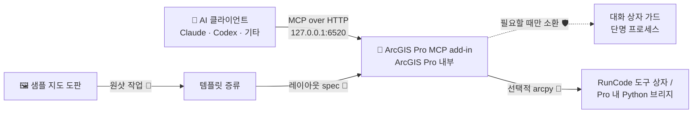

[](README.md) [](README.zh-CN.md) [](README.ja.md) [](README.ko.md) [](LICENSE) [](https://www.esri.com/en-us/arcgis/products/arcgis-pro/overview) []() [](../../releases)

# 🗺️ ArcGIS Pro MCP · AgentKit ⚡

**하나의 저장소, 세 개의 부품 — AI 코파일럿이 마침내 열려 있는 지도에 손을 얹습니다 (｀・ω・´)ゞ**

파일을 이리저리 넘길 필요도, "내보내기 → 업로드 → 다운로드" 의식도 없습니다. 어시스턴트가 눈앞의 ArcGIS Pro 세션과 직접 대화합니다: 당신의 데이터, 당신의 지도, 당신의 레이아웃. 🔒 모든 통신은 `127.0.0.1` 안에서만 이루어집니다.

> **📌 버전 공지(2026-11-16):** **1.0 에디션([v1.1.4](../../releases/tag/v1.1.4))은 매우 안정적이며 일상 사용에 권장됩니다.** **v2.0.0은 현재 테스트 단계**에 있어 아직 프로덕션용으로 권장하지 않습니다 — 안정판 패키지는 [Release v1.1.4](../../releases/tag/v1.1.4)에서 다운로드하세요.
>
> **📌 브랜치 공지:** `customer-v2.0.0`은 복원된 2.0.0 고객 패키지 이력 브랜치입니다. 새 프로젝트에는 **V2.01([v2.0.1](../../releases/tag/v2.0.1))**을 사용하세요. 이 README의 매핑 / 가드 / 증류 프롬프트 가이드는 동일하게 적용되지만, 수정된 `template_preview --out` 처리는 v2.0.1을 사용하세요.

> ### 🙏 업스트림 프로젝트와 원저자
> 이 프로젝트는 **[Knight60/ArcGIS-Pro-MCP](https://github.com/Knight60/ArcGIS-Pro-MCP)**의 어깨 위에 서 있습니다.
> 원저자는 **Pisut Nakmuenwai**, 라이선스는 **AGPL-3.0-or-later**. 진심으로 감사합니다! 🌟
> 로컬 패치를 **v2.0.0**까지 누적하고 guard / distill 모듈을 추가했습니다. 업스트림 저작자 표시는 [NOTICE](NOTICE)와 소스 스냅샷에 있습니다.

---

## ✨ 무엇인가

평범한 말로 말하기만 하면 — *"군을 면적으로 색칠해 줘, 파스텔 레드에서 그린으로"* — 지도가 바뀌는 것을 보게 됩니다. 🎨

| | 부품 | 역할 | 상태 |
|---|---|---|---|
| 🧩 | **MCP** | ArcGIS Pro add-in: **네이티브 125개 도구**(인프로세스, 약 9 ms ⚡), 모든 지오프로세싱 도구, 선택적 RunCode / Python 브리지 arcpy. `127.0.0.1:6520/mcp`에서 수신. | **v2.0.1 프리뷰 · 실기 검증됨** 🧪 · 안정판: v1.1.4 |
| 🛡️ | **Guard** | "서드파티 코드 라이브러리" 신뢰 대화 상자용 온디맨드 가드. 필요할 때만 소환되고, 직후에 사라집니다. 🥷 | **준비 완료** — [guard.md](docs/guard.md) |
| 🧪 | **Distill** | 온디맨드 템플릿 증류: 샘플 도판 → 재사용 가능한 레이아웃 spec. 원샷, 데몬 없음, 완전 재현 가능. 🧬 | **준비 완료** — [distill.md](docs/distill.md) |

### 🧠 왜 "온디맨드"인가(좀비 프로세스를 좋아하는 사람은 없으니까 🧟)

- 🥷 **상주 제로.** 위험한 작업이 없으면 가드 프로세스도, 폴링도 없습니다 — 작업 관리자가 조용합니다.
- 🛡️ **가드는 정확히 한 번의 작업 동안만 산다.** 신뢰 대화 상자가 나타날 수 있는 직전에 소환되고, 작업이 잦아들면 바로 해산. 자동 클릭 성공 = 알아챌 수 없음 ✨; 실패 = 최상위 경고(30초 이상, 소리 포함) 🚨. 클릭하는 것은 서드파티 코드 신뢰 대화 상자뿐 — 덮어쓰기/삭제 확인? 절대 건드리지 않습니다. 🙅
- 🧪 **증류는 원샷 작업이다.** 받은편지함 감시도, 서비스도 없습니다. 필요할 때 실행하세요; 모든 단계는 멱등이고 재개 가능합니다. ✅



---

## 🚀 빠른 시작 — 고객 에디션

v2.0.1은 ArcGIS Pro 3.7에서 실기 테스트(125개 도구, 자동 가드, RunCode, template_*)를 통과했지만 여전히 **프리뷰/프리릴리스**입니다. 안정판 기본은 v1.1.4입니다:

- ✅ **안정판 · 권장:** [**Release v1.1.4**](../../releases/tag/v1.1.4) → `ArcGIS-Pro-MCP-v1.1.4.zip` — add-in 1.1.4, stdio 브리지, RunCode, 대화 상자 가드, Python 브리지, 설치 프로그램, 문서, 전체 AGPL 소스 스냅샷(모든 파일이 번들된 `SHA256SUMS.txt`로 검증 가능)
- 🧪 **프리뷰 · 실기 검증됨:** [**Release v2.0.1**](../../releases/tag/v2.0.1) → `ArcGIS-Pro-MCP-v2.0.1.zip` — add-in 2.0.1, 온디맨드 가드 엔진, 번들 Distill 런타임, 설치 프로그램의 템플릿 라이브러리 수정
- 🗄️ **이전 프리뷰:** [**v2.0.0**](../../releases/tag/v2.0.0)(프리릴리스, 보존됨)
- 👀 소스 보기: [**`customer-v1.1.4`**](../../tree/customer-v1.1.4)(안정) · [**`customer-v2.0.0`**](../../tree/customer-v2.0.0)(프리뷰)
- 🛺 명령 하나로 끝내고 싶다면? 아래 [NuGet 설치 프로그램](#-install-via-nuget-github-packages)을 사용하세요 ⬇️

1. 📂 아무 곳에나 압축 해제 → `install/00-install.cmd` 더블클릭(관리자 불필요; ArcGIS Pro **3.7 이상** 필요).
2. 🖥️ ArcGIS Pro 열기 → 서명되지 않은 add-in 신뢰를 물으면 "예" 😄 → **MCP** 탭이 **running**(포트 `127.0.0.1:6520`)인지 확인.
3. 🔌 AI 클라이언트 연결(아래 구성 섹션 참조).
4. ✅ `install/01-check.cmd` 실행 — 전부 `[OK]`면 완벽합니다 (๑•̀ㅂ•́)و✧

Python 🐍 불필요, pip 📦 불필요, 인터넷 🌐 불필요: add-in은 ArcGIS Pro 3.7 이상에 포함된 .NET 런타임에서 동작하고, 브리지/가드는 Windows 기본 PowerShell을 사용합니다. `SHA256SUMS.txt`가 모든 파일을 커버합니다. 🔐

### 🛺 NuGet으로 설치(GitHub Packages)

명령 하나가 좋다면 [`ArcGISProMCP.Install`](../../pkgs/nuget/ArcGISProMCP.Install) dotnet 도구가 릴리스 zip을 다운로드하고 `SHA256SUMS.txt`로 모든 파일을 검증한 뒤 `install/00-install.cmd`를 실행합니다. .NET SDK와 `read:packages` 권한이 있는 [PAT](https://github.com/settings/tokens)가 필요합니다:

```powershell
# 최초 1회: GitHub Packages NuGet 원본 등록
dotnet nuget add source "https://nuget.pkg.github.com/XNYGggg/index.json" --name github --username XNYGggg --password <YOUR_PAT> --store-password-in-clear-text

dotnet tool install --global ArcGISProMCP.Install --version 1.1.4   # 안정판; 2.0.1은 프리뷰
arcgis-pro-mcp-install              # --dry-run을 붙이면 다운로드+검증만
```

---

## 🎛️ 구성 — AI 클라이언트 연결

**전제 조건:** ArcGIS Pro가 열려 있고 **MCP** 탭이 **running**을 표시해야 합니다. 모든 포트는 루프백 전용입니다:

| 포트 | 용도 |
|---|---|
| `6520` | MCP over HTTP — 모든 AI 클라이언트가 여기에 연결 |
| `6510` | 레거시 TCP 브리지(오늘날 클라이언트는 사용하지 않음) |
| `6511` | 선택적 Pro 내 Python 브리지(`execute_arcpy_code`) |

### 🟣 Claude Code

```powershell
claude mcp add --transport http arcgis http://127.0.0.1:6520/mcp
claude mcp list
```

`~/.claude.json`의 수동 등가 구성:

```json
{ "mcpServers": { "arcgis": { "type": "http", "url": "http://127.0.0.1:6520/mcp" } } }
```

제거는 `claude mcp remove arcgis`; 같은 명령으로 다시 추가합니다.

### 🖥️ Claude Desktop(번들 stdio 브리지)

Claude Desktop은 HTTP 서버로 직접 연결할 수 없고 로컬 프로세스를 실행합니다. 번들 PowerShell 브리지(Python 불필요)를 사용하세요:

1. **Claude Desktop 완전 종료**(트레이 아이콘 포함).
2. `install/02-configure-claude.cmd` 실행, 또는 설정을 수동 편집(파일은 자동 백업됩니다).
3. 설정 파일은 다음 중 처음으로 존재하는 폴더에 있습니다:
   `%APPDATA%\Claude`, `%APPDATA%\Claude-3p`, `%LOCALAPPDATA%\Claude-3p`, `%LOCALAPPDATA%\Claude` — 파일명 `claude_desktop_config.json`.

```json
{
  "mcpServers": {
    "arcgis": {
      "command": "C:\\Windows\\System32\\WindowsPowerShell\\v1.0\\powershell.exe",
      "args": ["-NoProfile", "-ExecutionPolicy", "Bypass", "-File",
               "C:\\Users\\<you>\\AppData\\Local\\ArcGIS Pro MCP\\stdio-bridge.ps1"]
    }
  }
}
```

4. Claude Desktop을 다시 열면 도구 목록에 `arcgis`가 나타납니다.

### 🟢 Codex

`~/.codex/config.toml`에 추가(기존 `arcgis` 섹션이 있으면 교체):

```toml
[mcp_servers.arcgis]
url = "http://127.0.0.1:6520/mcp"
```

Codex 재시작.

### 🔧 기타 MCP 클라이언트

`http://127.0.0.1:6520/mcp`로 Streamable HTTP를 사용하거나 위의 범용 JSON을 사용합니다. (Antigravity는 `serverUrl`을 원하고 `type`은 없어야 합니다.)

### ✅ 연결 확인

- `install/01-check.cmd` — Pro 버전, add-in 해시, 런타임, 포트, 클라이언트 구성을 점검합니다.
- `netstat -ano | findstr 6520` — 포트가 수신 중인지 확인합니다.
- 로그: `%LOCALAPPDATA%\ArcGIS-MCP\addin.log`.

---

## 🎯 사용 방법

**루프:** 데이터가 있는 프로젝트 열기 → 원하는 것을 말하기 → 어시스턴트가 알맞은 도구를 선택 → 결과 확인(이미지는 인라인으로 돌아옵니다). 🎨

| 이렇게 말하면 | 벌어지는 일 |
|---|---|
| "군을 면적으로 색칠해 줘, 파스텔 레드에서 그린으로" | `set_layer_renderer`(단계 구분) |
| "인구 50만 초과 군을 선택해서 내보내 줘" | `select_features` → `export_features` |
| "도로를 500m 버퍼해 줘" | `run_geoprocessing_tool`(Buffer) |
| "향·진별 경지면적은 얼마야?" | `summarize_features` / `zonal_statistics` |
| "현재 지도 뷰를 보여 줘" | `export_map_view`(PNG 반환) |
| "제목·범례·축척 막대·북쪽 화살표가 있는 A3 세로 PDF를 만들어 줘" | `create_layout` → `add_map_frame` → `add_layout_*` → `export_layout` |
| "레이어 12개를 모두 같은 심볼로 내보내 줘" | `run_batch` 또는 `execute_arcpy_code` |

**도구 수준 사용법.** 아래 카탈로그의 모든 도구는 클라이언트에서 이름으로 호출할 수 있습니다. `run_batch`는 여러 명령을 한 번의 왕복으로 연쇄하고, `execute_arcpy_code`는 전용 도구가 커버하지 못하는 작업을 위한 만능 탈출구입니다.

**편집 규칙.** 편집은 `save_edits` 전까지 보류됩니다 — 보류 중 편집은 데이터를 잠그므로 저장할 때까지 데이터셋 삭제나 덮어쓰기가 실패합니다. `discard_edits`로 버릴 수 있습니다. `delete_features` / `delete_dataset`은 되돌릴 수 없습니다: 먼저 어시스턴트에게 영향 범위를 말하게 하세요.

**선택 구성 요소의 온디맨드 사용.**
- 🐍 RunCode 도구 상자: `%LOCALAPPDATA%\ArcGIS Pro MCP\runcode\RunCode.pyt` — Pro 세션마다 첫 실행에서 신뢰 대화 상자가 뜹니다; 먼저 가드를 시작하세요.
- 🔌 Python 브리지: Pro의 Python 창에 붙여 넣기(`sys.path.insert(0, r"...\ArcGIS Pro MCP\plugin")`, 이어서 `mcp_bridge.start_server(port=6511)`); `CURRENT`에는 `mcp_bridge.start_pump()` 추가.
- 🛡️ 대화 상자 가드: `install\03-dialog-guard.cmd`(600초), `-AlertOnly`, `-NotifyTest`.

---

## 🎨 매핑과 지도 제작 — 프롬프트 가이드

이 섹션은 *어시스턴트에게 말하는 방법*에 관한 것입니다. 도구 이름을 댈 필요는 없습니다: 아래 4가지 요소를 말하면 어시스턴트가 MCP 호출로 변환합니다.

### 이 네 가지만 말하면 한 번에 끝납니다

| 요소 | 말할 내용 | 예시 |
|---|---|---|
| 데이터 | 레이어 이름, 데이터셋 경로, 현재 선택 | "현재 지도의 `counties` 레이어" |
| 작업 | 분류 필드/방법, 버퍼 거리, 통계 | "`AREA`로 5개 클래스, 자연 분류" |
| 스타일 | 색상, 글꼴 크기, 범례/축척 막대/북쪽 화살표 배치, 베이스맵 | "파스텔 레드에서 그린, 범례는 오른쪽 아래" |
| 출력 | 이미지/PDF/새 피처 클래스, 해상도, 저장 경로 | "A3 가로 PDF, 300 dpi, `D:\out\`에 저장" |

**좋은 프롬프트 vs 나쁜 프롬프트**
- ❌ "내 지도를 더 예쁘게 만들어 줘." — 목표가 없어 어시스턴트는 추측할 수밖에 없습니다.
- ✅ "`landuse`를 `DLMC` 기준 고유값으로 심볼화하고, 색은 템플릿 `tpl-xxx` 참조, 범례는 오른쪽 아래, 그런 다음 A3 가로 PDF를 300 dpi로 `D:\out\landuse.pdf`에 내보내 줘."
- ❌ "지도 하나 만들어 줘." — 범위, 레이아웃, 출력이 없습니다.
- ✅ "`study_area` 레이어 범위로 1:10,000, A4 세로 PNG, 제목 '대상 구역 토지이용', 범례·축척 막대·북쪽 화살표 포함. 먼저 미리보기를 보내 줘."

### 도구 그룹별 프롬프트 치트시트

| 모듈(도구 그룹) | 이렇게 말하세요 | 어시스턴트가 쓰는 것 |
|---|---|---|
| 세션과 프로젝트 | "먼저 `diagnose`를 실행하고, 프로젝트를 `D:\proj\result.aprx`로 저장해 줘" | diagnose / save_project |
| 레이어 | "`roads`를 `basemap` 그룹으로 옮기고, 투명도 40%, 1:50,000 이하에서만 표시; `POI`는 꺼 줘" | move_layer / set_layer_transparency / set_layer_scale_range / set_layer_visibility |
| 데이터와 속성 | "`parcels`의 처음 20행을 면적순으로 읽고; `DLMC` 클래스별 면적을 집계해 줘" | get_features / summarize_features |
| 선택 | "`POP`이 50만 초과인 군을 선택해 `D:\out\counties_big.shp`로 내보내고; 그다음 `study_area` 내 필지를 선택해 줘" | select_features / select_by_location / export_features |
| 스키마와 데이터셋 | "`parcels`에 DOUBLE 필드 `AREA_HA`를 추가하고 `!Shape_Area!/10000`으로 계산; EPSG:4547로 폴리곤 피처 클래스 `result_2026`을 만들어 줘" | add_field / calculate_field / create_feature_class |
| 지오프로세싱 | "도로를 500m 버퍼하고 디졸브; `study_area`를 마스크로 토지이용 래스터를 클립해 줘" | run_geoprocessing_tool / run_batch |
| 심볼 | "면적으로 단계 구분, 5개 자연 분류, 파스텔 레드에서 그린; 또는 `TYPE` 기준 고유값" | set_layer_renderer |
| 지도 뷰 | "`study_area`로 1:10,000 확대하고 1600×900 PNG를 보내 줘" | set_map_view / zoom_to_layer / export_map_view |
| 레이아웃과 내보내기 | "A3 가로 레이아웃을 만들고, 제목…, 범례는 레이어 3개만, 축척 막대와 북쪽 화살표 추가, 300 dpi PDF로 내보내 줘" | create_layout / add_layout_* / export_layout |
| 래스터 | "DEM의 밴드, 셀 크기, 통계를 읽고; NDVI를 계산해 줘" | get_raster_info / raster_calculator / zonal_statistics |
| 카탈로그와 데이터 탐색 | "프로젝트와 폴더 연결에서 이름에 `2025`가 들어간 셰이프파일을 찾아 줘" | search_data / describe_dataset / list_folder |
| 유틸리티 | "한 번에 해 줘: 베이스맵 숨기기 → 군으로 확대 → PNG 내보내기; arcpy로 모든 레이어 이름에 접두사 붙이기" | run_batch / execute_arcpy_code |

### 표준 지도 제작 프롬프트(복사해서 채우기)

```text
현재 프로젝트의 <지도 이름>에서 지도를 만들어 주세요:
- 범위: <대상 구역 레이어/범위>, 축척 1:<...>
- 데이터: <레이어1>, <레이어2> (필요하면 필드와 필터 추가)
- 심볼: <단계 구분/고유값/단일 심볼>, 색상 <램프 또는 hex>
- 레이아웃: <A3 가로 / A4 세로>, 제목 "<제목>", 범례 <위치>, 축척 막대 <위치>, 북쪽 화살표 <위치>
- 출력: <PDF / PNG>, <300> dpi, <절대 경로>에 저장
- 진행 방식: 레이아웃을 자체 점검하고 미리보기를 보내 주세요. 제가 확인한 뒤 최종 파일을 내보내세요.
```

### 배치 내보내기 프롬프트

```text
`maps`의 모든 지도에 대해 같은 A3 가로 레이아웃으로 PDF를 내보내 주세요:
제목 = 지도 이름, 범례 = 표시 중인 레이어만, 축척 막대와 북쪽 화살표는 오른쪽 아래,
`D:\out\maps\`에 300 dpi로 출력. 먼저 한 장을 내보내 확인받고 나머지를 배치 처리하세요.
```

### 뭔가 이상할 때 한 줄 수정

- "범례가 지도를 덮고 있어" → `legend` 박스나 레이아웃을 조정.
- "페이지 비율이 이상해 / 여백이 너무 많아" → 지도 프레임과 페이지 비율을 조정.
- "색이 너무 쨍해 / 저널 스타일이 아니야" → 색상 램프, hex 코드, 템플릿 ID를 지정.
- "아직 내보내지 말고 — 미리보기를 보여 줘" → 먼저 `export_map_view` 또는 레이아웃 미리보기.

**효과:** 데이터, 작업, 스타일, 출력을 처음에 다 말하면 보통 한 번에 거의 최종본 지도를 얻습니다. 이후 조정은 차이만 말하면 됩니다("범례를 오른쪽으로 1cm"). 브리프를 통째로 다시 말할 필요가 없습니다.

---

## 🛡️ 가드 모듈 — 프롬프트 가이드

**해결하는 문제:** ArcGIS Pro가 서드파티 `.pyt` / Python 도구(RunCode.pyt 등)를 처음 실행할 때 "서드파티 코드 라이브러리" 신뢰 대화 상자가 뜹니다. 무인 작업은 거기서 멈춥니다. 가드는 그 대화 상자가 나올 수 있는 작업 직전에만 소환되어 "是(Y)"를 클릭하고, 작업이 잦아들면 바로 종료됩니다.

**두 가지 트리거 모드**
1. **자동(2.x 기본):** `run_python_toolbox_tool` / `execute_arcpy_code` 전에 add-in이 가드를 arm하고 종료 후 settle합니다 — 보통 당신 쪽에서 할 일이 없습니다.
2. **수동 `guard_summon`:** Pro에서 직접 실행하는 `.pyt` 도구, ENVI→Pro 가져오기, 어시스턴트 밖의 모든 작업용.

**프롬프트 예시**

| 이렇게 말하면 | 어시스턴트가 하는 일 |
|---|---|
| "이제 Pro에서 직접 RunCode.pyt를 실행할 거야. 가드를 10분간 소환해 줘. 서드파티 신뢰 대화 상자가 나오면 '是'를 클릭하고, 못 하면 최상위로 소리 나는 경고를 띄워 줘" | `guard_summon`(timeout_s≈600) |
| "이번엔 경고만 — 클릭하지 마" | `guard_summon`(alert_only) |
| "방금 가드 세션이 정상 종료됐는지 확인해 줘" | `guard_status` |
| "RunCode 실행 전에 가드를 arm해 줘" | 자동 arm + settle |

**경계와 파라미터**
- 클릭하는 것은 "서드파티 코드 라이브러리" 신뢰 대화 상자뿐입니다. 덮어쓰기, 삭제, 그 밖의 확인은 절대 건드리지 않습니다.
- 버튼을 찾을 수 없으면 최상위 경고가 최소 30초 유지되고 10초마다 울립니다.
- `timeout_s`는 가드 수명을 제어합니다; `guard_status`는 엔진 경로/버전과 최근 20개 세션을 보고합니다.
- 신뢰는 Pro 프로세스별로 기억됩니다. Pro를 재시작하면 대화 상자가 다시 나올 수 있습니다.
- 1.1.4에는 `guard_summon`이 없습니다; 번들된 `install\03-dialog-guard.cmd`(기본 600초)로 같은 가드를 사용하세요.

**효과:** 무인 RunCode / ENVI 연계 워크플로가 대화 상자에서 멈추지 않습니다. 자동 클릭이 실패해도 최상위 경고와 소리가 있어 조용히 실패할 수 없습니다.

---

## 🧪 증류 모듈 — 프롬프트 가이드

여기서 "증류"는 **모델 학습이 아닙니다**. **샘플 도판**(저널 그림, 교재 그림, 모범 지도)의 레이아웃 지식 — 프레임 지오메트리, 색상 구성, 글꼴 크기, 범례/축척 막대/북쪽 화살표 배치, 알려진 함정 — 을 이후의 지도 제작 작업이 따를 수 있는 재사용 가능한 JSON 템플릿 spec으로 추출하는 것입니다.

**얻는 것:** `template_id`와 `canvas`(크기/DPI), `map_frame`, `title / legend / scale_bar / north_arrow`, `palette`, `typography`, `regions[]`, `pitfalls[]`, `measured`(측정 증거), `review`(인간 승인)를 담은 spec. 라이브러리는 기본적으로 `%LOCALAPPDATA%\ArcGIS Pro MCP\library`에 있습니다.

**효과**
- 같은 프로젝트나 논문의 여러 그림에서 레이아웃이 일관됩니다.
- 범례 위치, 제목 크기, 색 구성에 대해 매번 구두 브리핑할 필요가 없습니다.
- 감사 가능: 모든 템플릿에 측정 출처, patch 내용, 검토자와 날짜가 남습니다.
- 피할 수 있는 실수가 줄어듭니다: `pitfalls[]`가 "범례가 지도를 덮음" 같은 문제를 실행 가능한 검사로 바꿉니다.

**워크플로와 프롬프트**

| 단계 | 이렇게 말하세요 | 어시스턴트 호출 | 확인할 것 |
|---|---|---|---|
| 1 가져오기 | "`D:\samples\fig3.png`를 '대상 구역 개요'라는 이름의 템플릿으로 증류해 줘. 태그: journal-style" | `template_import` | 반환된 `template_id` |
| 2 측정 | "측정해 줘" | `template_measure` | `h_lines/v_lines`, `palette_top`, DPI |
| 3 의미론 | 어시스턴트가 도판을 읽고 patch(프레임, 범례, 글꼴, regions, pitfalls)를 작성 | `template_patch` | patch의 좌표와 글꼴 크기 |
| 4 검증 | "검증해 줘" | `template_validate` | 오류 0; warning은 허용 가능한지 |
| 5 미리보기 | "미리보기를 보여 줘" | `template_preview` | 샘플과 나란히 놓은 와이어프레임 |
| 6 검토 / 승인 | "확인했어. 검토자 Liu Haowen, 메모: 레이아웃 확인 완료" → "승인해 줘" | `template_review` → `template_approve` | 상태가 `ready`로 |
| 7 적용 | "템플릿 `tpl-xxx`로 이 프로젝트 지도를 만들어 줘" | `template_apply` → 매핑 도구 | 출력이 템플릿 레이아웃과 일치 |

**복사-붙여넣기 프롬프트**

1. **단일 도판 완전 증류**

```text
`D:\samples\fig3.png`를 레이아웃 템플릿으로 증류해 주세요:
- 이름: 대상 구역 개요; 태그: journal-style, A4 가로
- 전체 흐름 실행: import → measure → patch → validate → preview
- 의미 필드(프레임, 범례, 축척 막대, 북쪽 화살표, 글꼴 크기, 색 구성, regions, pitfalls)는 도판을 직접 읽고 판단하세요
- 각 단계의 핵심 결과를 보고하고, 미리보기를 보여 주고 제 OK를 기다린 뒤 review + approve
- 측정값을 직접 편집하지 마세요
```

2. **배치 수집(먼저 측정만)**

```text
`D:\samples\` 아래의 모든 PNG를 스캔해서 하나씩 import + measure 하세요. 이름은 파일명,
모두 `candidate` 태그를 붙이세요. 의미 patch는 아직 쓰지 마세요; 측정 요약표를 주면
제가 정련할 대상을 고르겠습니다.
```

3. **템플릿으로 지도 만들기**

```text
템플릿 `tpl-20261116-172854-57ec`로 현재 프로젝트에 지도를 만들어 주세요:
먼저 template_apply를 호출하고, map_frame/palette/typography/pitfalls에 따라
제목 "대상 구역 토지이용"의 A4 가로 레이아웃을 만들고, 300 dpi PDF를 `D:\out\landuse.pdf`에 내보내세요.
자체 점검 결과와 미리보기를 보내 인수 확인을 받으세요.
```

4. **ready 템플릿 편집**

```text
템플릿 `tpl-xxx`의 범례를 오른쪽 아래(x=0.78, y=0.78, w=0.16, h=0.16)로 옮기고
제목 크기를 22로. validate와 preview를 다시 실행해 결과를 보여 주세요; measured는 건드리지 마세요.
제가 확인하면 다시 review + approve 하세요.
```

5. **템플릿 이전 / 공유**

```text
`tpl-xxx`를 bundle.zip으로 내보내고, 다른 머신의 템플릿 라이브러리에
bundle-import 한 뒤 새 template_id와 상태를 나열하세요.
```

**어시스턴트가 반드시 지켜야 할 하드 룰**
- 의미론적 판독은 [skills/template-distill/SKILL.md](skills/template-distill/SKILL.md)를 따릅니다; 결정적 단계를 "즉흥적으로" 하지 않습니다.
- `measured / id / image_sha256 / source_image / schema_version`은 보호 필드이며, 포함한 patch는 거부됩니다. 캔버스를 바꾸려면 `measure --force`를 다시 실행하거나 `canvas.height_in`을 3% 허용 오차 내에서 맞춥니다.
- `ready`는 검증과 인간 검토가 모두 필요합니다; 검토 없는 `approve`는 거부됩니다. `--force`는 당신의 명시적 요청 시에만 사용되고 검토 기록에 남습니다.
- 미리보기는 당신에게 제시하고 샘플과 대조한 뒤에만 승인할 수 있습니다.
- 저널/교재 샘플 도판은 기본적으로 로컬 라이브러리에만 둡니다 — 공개 bundle을 내보내지 마세요(저작권).

**FAQ**
- **미리보기 실패 / 이미지 없음:** 이 v2.0.0 브랜치에는 `run-distill.ps1`의 `--out` 바인딩 버그가 있습니다; v2.0.1을 사용하거나 `python -m arcgis_agentkit.distill preview`를 직접 호출하세요.
- **도판 밴드가 감지되지 않음:** 샘플이 너무 어둡거나 흐리거나 밝은 밴드가 없습니다; 깨끗한 전체 스크린샷을 사용하세요.
- **3% 캔버스 허용 오차 오류:** `canvas.height_in`이 측정값과 불일치; 캔버스를 고치거나 다시 측정하세요 — `measured`를 직접 편집하지 마세요.
- **`ready` 템플릿은 변경할 수 없음:** spec을 복사하거나 새 id로 다시 가져오세요. 납품된 템플릿을 깨뜨리지 마세요.

---

---

## 🧰 전체 125개 MCP 도구(14개 그룹)

어시스턴트가 할 수 있는 모든 것을 이름으로 나열합니다. 클릭해서 펼치세요 👇

<details>
<summary><b>📜 전체 도구 카탈로그 — 세션 15 · 레이어 19 · 데이터 11 · 선택 6 · 스키마 11 · 지오프로세싱 7 · 심볼 6 · 뷰 7 · 레이아웃 16 · 래스터 5 · 카탈로그 6 · 유틸리티 4 · 가드 2 · 템플릿 10</b></summary>

### 세션(15)

| 도구 | 역할 |
|---|---|
| `ping` | ArcGIS Pro 브리지에 도달할 수 있는지 확인하고 어떤 프로젝트에 연결되어 있는지 표시합니다. |
| `get_capabilities` | 연결된 브리지가 지원하는 모든 명령을 영역별로 나열합니다. 이름 있는 도구 외의 기능을 발견하는 데 사용합니다. |
| `get_queue_status` | 브리지의 큐 상태: 레인별 대기 수, 현재 실행 중인 명령, 최근 완료 이력. 호출이 느리거나, 큐에 쌓이거나, 'lane busy' 오류가 날 때 확인합니다. |
| `diagnose` | 연결 자체 점검: ArcGIS Pro 버전, 라이선스, 열린 프로젝트, 활성 지도, 열린 지도 뷰, 쓰기 권한. 뭔가 안 될 때 먼저 실행합니다. |
| `get_arcgis_info` | ArcGIS Pro 버전, 라이선스 수준, 사용 가능한 확장 모듈, 현재 프로젝트 경로. |
| `get_project_info` | 프로젝트 경로, 기본 지오데이터베이스와 도구 상자, 지도, 레이아웃, 폴더·데이터베이스 연결. |
| `save_project` | ArcGIS Pro 프로젝트(.aprx)를 저장하거나 다른 위치에 사본으로 저장합니다. |
| `list_maps` | 모든 지도와 씬을 좌표계·레이어 수와 함께 나열합니다. |
| `create_map` | 프로젝트에 새 지도 또는 씬을 만듭니다. |
| `remove_map` | 프로젝트에서 지도를 삭제합니다. |
| `activate_map` | 지도 뷰를 ArcGIS Pro UI에서 열거나 활성화합니다. 카메라 명령과 export_map_view 전에 필요합니다. |
| `set_map_properties` | 지도 이름을 바꾸거나 좌표계를 변경합니다. |
| `get_map_extent` | 지도 내 모든 데이터 레이어의 합산 범위. |
| `get_environment` | 현재 arcpy 지오프로세싱 환경 설정을 읽습니다. |
| `set_environment` | workspace, outputCoordinateSystem, extent, mask, cellSize, overwriteOutput, parallelProcessingFactor 같은 arcpy 지오프로세싱 환경을 설정합니다. |

### 레이어(19)

| 도구 | 역할 |
|---|---|
| `get_layers` | 지도의 레이어(그리기 순서와 그룹 중첩 포함)와 독립 테이블을 나열합니다. 프로젝트 내용을 보려면 여기서 시작하세요. |
| `get_layer_info` | 레이어 하나의 상세 정보: 데이터 원본, 좌표계, 범위, 필드, 피처 수, 렌더러, 라벨 상태. |
| `add_layer` | 경로 또는 서비스 URL에서 데이터를 지도에 추가: 피처 클래스, 셰이프파일, 래스터, 테이블, .lyrx 레이어 파일, 웹 서비스. |
| `add_web_layer` | URL로 웹 서비스 레이어 추가(Feature/Map/Image 서비스, WMS, WMTS, 벡터 타일). |
| `remove_layer` | 지도에서 레이어 또는 독립 테이블을 제거합니다. |
| `rename_layer` | 콘텐츠의 레이어 이름을 바꿉니다. |
| `duplicate_layer` | 지도 내에서 레이어를 복제해 다른 심볼을 지정할 수 있게 합니다. |
| `set_layer_visibility` | 레이어 하나, 여러 개, 또는 지도의 모든 레이어 표시/숨김을 전환합니다. |
| `set_layer_transparency` | 레이어 투명도를 설정합니다(0 = 불투명, 100 = 완전 투명). |
| `set_layer_scale_range` | 레이어가 그려지는 축척 범위를 제한합니다. |
| `set_definition_query` | 레이어의 정의 쿼리(SQL where 절)를 설정합니다. 빈 문자열이면 해제. |
| `move_layer` | 레이어를 다른 레이어 기준으로 재배치하거나 그룹 레이어로 옮깁니다. |
| `create_group_layer` | 그룹 레이어를 만들고, 필요하면 기존 레이어를 그 안으로 옮깁니다. |
| `zoom_to_layer` | 지도 뷰를 레이어 범위로 확대합니다. |
| `set_basemap` | 베이스맵을 설정: Topographic, Imagery, Imagery Hybrid, Streets, Navigation, Light Gray Canvas, Dark Gray Canvas, Terrain, Oceans, OpenStreetMap, National Geographic Style Map. |
| `get_broken_layers` | 모든 지도에서 데이터 원본이 누락된 레이어를 나열합니다. |
| `repair_layer_source` | 끊어진 데이터 원본을 고치기 위해 레이어를 새 워크스페이스나 데이터셋으로 다시 지정합니다. |
| `add_join` | 공통 필드로 테이블을 레이어에 조인합니다. |
| `remove_join` | 레이어의 조인을 해제합니다. |

### 데이터(11)

| 도구 | 역할 |
|---|---|
| `get_features` | 레이어, 테이블, 데이터셋 경로에서 속성 행을 읽습니다. where 절, 필드 부분 지정, 정렬, WKT 지오메트리를 선택적으로 지정. |
| `count_features` | 피처 수를 셉니다. where 절 일치 조건도 가능. |
| `get_unique_values` | 필드의 고유값과 각각의 행 수를 반환합니다. |
| `get_field_statistics` | 숫자 필드의 min / max / 평균 / 중앙값 / 합계 / 표준편차. |
| `summarize_features` | 하나 이상의 필드로 행을 그룹화해 집계 — "범주별로 몇 개/얼마"를 지오프로세싱 없이 빠르게 답하는 방법. |
| `insert_features` | 레이어 또는 테이블에 새 행을 삽입합니다. |
| `update_features` | where 절에 맞는 행의 속성이나 지오메트리를 갱신합니다. |
| `delete_features` | where 절에 맞는 행을 삭제합니다. |
| `save_edits` | 보류 중인 편집을 확정합니다. ArcGIS Pro는 편집을 취소할 수 있도록 열어 두므로 저장 전까지 데이터도 잠깁니다 — 그때까지 편집된 데이터셋의 삭제나 덮어쓰기는 실패합니다. |
| `discard_edits` | 보류 중인 편집을 버립니다. |
| `calculate_field` | 레이어 전체의 필드 값을 계산합니다. 예: 식 "!Shape_Area! / 10000". |

### 선택(6)

| 도구 | 역할 |
|---|---|
| `select_features` | SQL where 절로 피처를 선택합니다. |
| `select_by_location` | 다른 레이어와의 공간 관계로 피처를 선택합니다. |
| `get_selection` | 현재 선택 상태를 레이어별로 ObjectID(필요하면 속성 행도)와 함께 보고합니다. |
| `set_selection` | ObjectID로 특정 피처를 선택합니다. |
| `clear_selection` | 레이어 하나 또는 지도의 모든 레이어 선택을 해제합니다. |
| `zoom_to_selection` | 지도 뷰를 현재 선택된 피처로 확대합니다. |

### 스키마(11)

| 도구 | 역할 |
|---|---|
| `list_fields` | 레이어의 필드를 유형, 별칭, 길이, 도메인과 함께 나열합니다. |
| `add_field` | 레이어 또는 테이블에 필드를 추가합니다. |
| `add_fields` | 여러 필드를 한 번의 호출로 추가합니다. |
| `delete_field` | 하나 이상의 필드를 삭제합니다. |
| `alter_field` | 필드 이름을 바꾸거나 별칭/길이를 변경합니다. |
| `create_feature_class` | 빈 피처 클래스를 만들고(기본값: 프로젝트 기본 지오데이터베이스) 지도에 추가합니다. |
| `create_table` | 빈 독립 테이블을 만듭니다. |
| `create_file_geodatabase` | 새 파일 지오데이터베이스를 만듭니다. |
| `truncate_table` | 스키마를 유지한 채 테이블 또는 피처 클래스의 모든 행을 삭제합니다. |
| `delete_dataset` | 디스크 또는 지오데이터베이스에서 데이터셋을 삭제합니다. 되돌릴 수 없습니다. |
| `export_features` | 레이어를 새 데이터셋으로 내보냅니다 — 현재 선택과 정의 쿼리가 반영됩니다. |

### 지오프로세싱(7)

| 도구 | 역할 |
|---|---|
| `run_geoprocessing_tool` | 모든 arcpy 지오프로세싱 도구 실행 — 분석을 위한 만능 탈출구. 레이어 이름은 열린 레이어로 해석되어 선택과 정의 쿼리가 적용됩니다. 파라미터 이름을 모르면 먼저 describe_geoprocessing_tool을 호출하세요. |
| `list_geoprocessing_tools` | 사용 가능한 지오프로세싱 도구를 이름으로 검색합니다. |
| `list_toolboxes` | arcpy 도구 상자 모듈과 프로젝트 내 도구 상자를 나열합니다. |
| `describe_geoprocessing_tool` | 실행 전에 도구의 파라미터, 데이터 유형, 기본값, 사용 설명을 가져옵니다. |
| `run_python_toolbox_tool` | 디스크의 사용자 지정 .pyt / .atbx / .tbx 도구 상자에서 도구를 실행합니다. |
| `check_extension` | ArcGIS 확장 모듈 라이선스를 확인하고 필요하면 체크아웃합니다. |
| `get_messages` | 가장 최근 지오프로세싱 작업의 메시지. |

### 심볼(6)

| 도구 | 역할 |
|---|---|
| `set_layer_renderer` | 레이어 심볼을 변경: 단일 심볼, 범주별 고유값, 숫자 필드 기준 분류/연속 색상 구성. |
| `get_layer_symbology` | 레이어의 현재 렌더러, 클래스 구분, 고유값, 라벨 설정을 확인합니다. |
| `list_color_ramps` | 프로젝트에서 사용 가능한 색상 램프를 나열합니다. |
| `set_layer_labeling` | 라벨을 켜고 끄며 식, 글꼴, 헤일로를 설정합니다. |
| `apply_symbology_from_layer` | .lyrx 파일 또는 다른 레이어에서 심볼을 복사합니다. |
| `save_layer_file` | 심볼이 포함된 레이어를 .lyrx 파일로 저장해 재사용합니다. |

### 뷰(7)

| 도구 | 역할 |
|---|---|
| `get_map_view` | 현재 카메라 위치: 중심, 축척, 회전, 가시 범위. ArcGIS Pro에서 지도 탭이 열려 있어야 합니다. |
| `set_map_view` | 지도 뷰를 이동: 범위, 중심점, 축척, 회전을 설정합니다. |
| `export_map_view` | 지도 뷰를 PNG로 렌더링해 눈으로 볼 수 있도록 이미지를 반환합니다 — 지도를 시각 확인하는 방법. ArcGIS Pro에서 지도 탭이 열려 있어야 합니다. |
| `list_bookmarks` | 지도에 정의된 공간 북마크를 나열합니다. |
| `create_bookmark` | 현재 뷰 또는 지정 범위를 이름 있는 북마크로 저장합니다. |
| `apply_bookmark` | 지도 뷰를 북마크로 확대합니다. |
| `delete_bookmark` | 지도에서 북마크를 삭제합니다. |

### 레이아웃(16)

| 도구 | 역할 |
|---|---|
| `list_layouts` | 인쇄 레이아웃을 페이지 크기와 요소 수와 함께 나열합니다. |
| `get_layout_info` | 레이아웃 검사: 페이지 설정과 모든 요소의 위치·크기. |
| `create_layout` | 새 레이아웃 페이지를 만듭니다(기본값: 페이지를 채우는 지도 프레임 포함). |
| `delete_layout` | 프로젝트에서 레이아웃을 삭제합니다. |
| `add_map_frame` | 레이아웃의 페이지 위치에 지도 프레임을 추가합니다. |
| `set_map_frame_extent` | 레이아웃의 지도 프레임을 레이어, 범위, 축척 중 하나에 맞춥니다. |
| `add_layout_text` | 제목이나 출처 같은 텍스트 요소를 레이아웃에 추가합니다. |
| `add_layout_legend` | 레이아웃의 지도 프레임과 연동된 범례를 추가합니다. |
| `add_layout_scale_bar` | 레이아웃의 지도 프레임과 연동된 축척 막대를 추가합니다. |
| `add_layout_north_arrow` | 레이아웃의 지도 프레임과 연동된 북쪽 화살표를 추가합니다. |
| `add_layout_picture` | 로고 같은 이미지를 레이아웃에 배치합니다. |
| `set_layout_element` | 임의의 레이아웃 요소를 이동, 크기 조정, 이름 변경, 숨기기, 텍스트 변경합니다. |
| `delete_layout_element` | 레이아웃에서 요소를 제거합니다. |
| `export_layout` | 레이아웃을 PDF / PNG / JPEG / SVG / TIFF로 내보냅니다. PNG와 JPEG는 확인할 수 있도록 인라인 이미지로 반환됩니다. |
| `preview_layout` | 파일을 쓰지 않고 레이아웃을 임시 이미지로 렌더링해 반환합니다 — 작성 중 시각 확인용. |
| `export_map_series` | 레이아웃의 지도 시리즈(맵북)를 여러 페이지 PDF로 내보냅니다. |

### 래스터(5)

| 도구 | 역할 |
|---|---|
| `get_raster_info` | 래스터 상세: 밴드, 크기, 셀 크기, 픽셀 유형, 통계, CRS. |
| `set_raster_symbology` | 래스터 레이어의 컬러라이저와 색상 램프를 설정합니다. |
| `raster_calculator` | 맵 대수. 래스터를 짧은 이름으로 묶고 그에 대한 Python 식을 씁니다. Spatial Analyst 확장 모듈이 필요합니다. |
| `sample_raster_values` | 지도 좌표 또는 포인트 레이어 피처 위치에서 래스터 셀 값을 읽습니다. |
| `zonal_statistics` | 존 폴리곤 내 래스터 값을 집계해 테이블을 반환합니다. Spatial Analyst 확장 모듈이 필요합니다. |

### 카탈로그(6)

| 도구 | 역할 |
|---|---|
| `list_workspace_contents` | 지오데이터베이스 또는 폴더 내 데이터셋을 나열합니다. 기본값은 프로젝트 기본 지오데이터베이스. |
| `list_folder` | 디스크의 GIS 파일과 하위 폴더를 나열합니다. 기본값은 프로젝트 홈 폴더. |
| `describe_dataset` | 어떤 데이터셋이든 경로로 설명 — 유형, 지오메트리, CRS, 범위, 필드, 행 수 — 지도에 추가하지 않고. |
| `search_data` | 프로젝트의 지오데이터베이스, 홈 폴더, 폴더 연결에서 이름으로 데이터셋을 검색. 추가 전에 데이터를 찾는 가장 빠른 방법입니다. |
| `get_project_items` | 프로젝트에 등록된 폴더 연결, 데이터베이스 연결, 도구 상자. |
| `add_folder_connection` | 폴더를 프로젝트에 등록해 데이터를 쉽게 찾아볼 수 있게 합니다. |

### 유틸리티(4)

| 도구 | 역할 |
|---|---|
| `execute_arcpy_code` | ArcGIS Pro 안에서 Python을 실행합니다. arcpy는 임포트되어 있고 arcpy.mp.ArcGISProject('CURRENT')가 열린 프로젝트입니다. 변수는 호출 간에 유지되고, print() 출력은 캡처되며, 마지막 식의 값이 반환됩니다. 전용 도구가 커버하지 못하는 작업에 사용하세요. |
| `get_pump_status` | 메인 스레드 디스패처가 설치되어 있는지 여부. 명령을 열린 ArcGIS Pro 프로젝트에 도달하게 하는 장치로, 없으면 경로 기반 작업(지오프로세싱, 데이터셋 검사)만 동작합니다. |
| `stop_pump` | 메인 스레드 디스패처를 제거합니다. 사용자가 다시 설치할 때까지 라이브 프로젝트 명령은 동작하지 않습니다. |
| `run_batch` | 여러 명령을 한 번의 왕복으로 실행 — 다단계 워크플로가 훨씬 빨라집니다. |

### 가드(2)

| 도구 | 역할 |
|---|---|
| `guard_summon` | 수동 단계용으로 온디맨드 대화 상자 가드를 소환합니다. 서드파티 코드 라이브러리 신뢰 대화 상자만 클릭하고, 못 하면 최상위 경고가 30초 이상 유지됩니다. `timeout_s` 후 종료됩니다. |
| `guard_status` | 가드 엔진 경로/버전, 세션 루트, 최근 20개 소환 세션. |

### 템플릿(10)

| 도구 | 역할 |
|---|---|
| `template_list` | 증류된 레이아웃 템플릿을 나열합니다. 상태나 태그로 필터링 가능. |
| `template_get` | 템플릿 spec 하나를 읽습니다(레이아웃, 색 구성, 글꼴, regions, pitfalls, 검토). |
| `template_import` | 샘플 도판을 초안으로 가져옵니다(sha256으로 중복 제거). |
| `template_measure` | 도판의 bbox, 종횡비, 프레임 선, 색 구성, DPI를 측정합니다. |
| `template_patch` | 의미 필드를 검증된 병합으로 제출합니다. 보호 필드는 거부됩니다. |
| `template_validate` | 스키마 + 기하 일관성 검사. |
| `template_review` | 인간의 검토 결정을 기록합니다. |
| `template_approve` | 검토·검증된 템플릿을 승인합니다(ready가 됨). |
| `template_preview` | 와이어프레임 미리보기를 이미지로 반환합니다. |
| `template_apply` | ready 템플릿을 매핑 컨텍스트 파일로 작성합니다. |

</details>

---

## 🗂️ 저장소 구조

```
├── main (this branch) 🏠      AgentKit 2.0.1 preview: MCP add-in 2.0.1 + guard + distill
├── customer-v2.0.0 🎁         v2.0.0/v2.0.1 preview release branch (merged into main)
├── customer-v1.1.4 🎁         previous customer edition (add-in 1.1.4), preserved
├── history-main-pre-2.0 🗄️    main before the 2.0 merge, preserved as history
├── installer/ 🛺              ArcGISProMCP.Install — NuGet tool: download → verify → run setup
├── addin/ArcGISProMCP/ 🧩     C# add-in (125 tools, GuardClient, template commands)
├── src/arcgis_pro_mcp/ 🐍     upstream Python stdio/CLI server (kept for rebase)
├── src/arcgis_agentkit/ 🧰    guard / distill Python packages (CLI + engine)
├── skills/ 🎓                 assistant-facing skills (template-distill, arcgis-pro-mapping)
├── library/ 📚                template library schema (v1.1) and examples
├── docs/ 📖                   design, architecture, guard and distill notes
└── tests/ 🧪                  pytest (guard handshake/rules, full distill pipeline)
```

개발용 설치:

```powershell
python -m pip install -e .
arcgis-guard doctor
arcgis-distill doctor
```

## 🛣️ 로드맵

1. ✅ **M1 — Guard 2.0**: 소환 프로토콜, 이벤트 우선 UIA 감지, add-in 자동 arm, 규칙 스키마, CLI, 테스트.
2. ✅ **M2 — Distill 2.0**: import / measure / patch / validate / preview / review / approve / apply, schema v1.1, 템플릿 MCP 도구.
3. ✅ **M3 — 릴리스**: 2.0.0/2.0.1 버저닝, 태그, 릴리스 자산, NuGet 패키지 출하; 코드 서명과 클린 VM 통과 검증이 남아 있습니다.

세부 사항, 인수 기준, 트레이드오프: [docs/design-2026-11-16.md](docs/design-2026-11-16.md). 2.0 도착했습니다 (๑•̀ㅂ•́)و✧

---

## 📜 라이선스 · 크레딧 · 면책

- ⚖️ **라이선스**: [AGPL-3.0-or-later](LICENSE). MCP 모듈은 AGPL-3.0-or-later 프로젝트에서 파생되었으므로 결합 저장소도 AGPL입니다.
- 🙏 **업스트림 프로젝트와 원저자**: [Knight60/ArcGIS-Pro-MCP](https://github.com/Knight60/ArcGIS-Pro-MCP) by **Pisut Nakmuenwai** — 감사합니다! 💐 로컬 변경은 [NOTICE](NOTICE), [RELEASE-NOTES.md](https://github.com/XNYGggg/arcgis-pro-mcp-optimized/blob/customer-v2.0.0/RELEASE-NOTES.md), 고객 패키지 내 `source/SOURCE-NOTICE.md`에 선언되어 있습니다.
- 🏷️ **상표**: Esri와 무관합니다. "ArcGIS"는 Esri의 상표입니다. 서드파티 도구이며 어떠한 보증도 없습니다.
- 🔒 **프라이버시 / 네트워크**: 모든 서비스는 `127.0.0.1`에만 바인딩됩니다; 텔레메트리 제로, 클라우드 호출 제로.
- 👤 **유지관리자**: Law([@XNYGggg](https://github.com/XNYGggg)).

[🇨🇳 简体中文说明](README.zh-CN.md) · Made with ☕ + 🗺️ + 一点点强迫症
