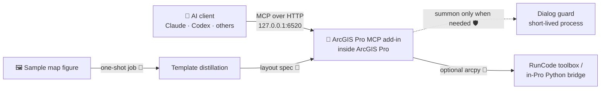

[](README.md) [](README.zh-CN.md) [-2ea44f?style=flat-square)](../../releases/tag/v1.1.4) [](LICENSE) [](https://www.esri.com/en-us/arcgis/products/arcgis-pro/overview) []() [](../../releases)

# 🗺️ ArcGIS Pro MCP · AgentKit ⚡

**One repo, three parts — your AI copilot finally gets hands on the map you already have open (｀・ω・´)ゞ**

No file juggling, no "export → upload → download" ritual. Your assistant talks to the ArcGIS Pro session right in front of you: your data, your maps, your layouts. 🔒 Everything stays on `127.0.0.1`.

> **📌 Version status (updated 2026-11-16)**
>
> - ✅ **v1.1.4 · stable · recommended** (113 tools): [**Release v1.1.4**](../../releases/tag/v1.1.4) → `ArcGIS-Pro-MCP-v1.1.4.zip`; NuGet: `dotnet tool install --global ArcGISProMCP.Install --version 1.1.4`.
> - 🧪 **v2.0.0 / v2.0.1 · testing · not recommended**: the 2.0 optimization is unfinished; GitHub Release assets and tags were removed (NuGet 2.0.x downloads will fail). The code remains on the `customer-v2.0.1` / `main` branches until 2.0 is ready.

> ### 🙏 Upstream project & original author
> This project stands on the shoulders of **[Knight60/ArcGIS-Pro-MCP](https://github.com/Knight60/ArcGIS-Pro-MCP)**,
> originally created by **Pisut Nakmuenwai**, licensed **AGPL-3.0-or-later**. Huge thanks! 🌟
> We carry local patches up to **V2.01 (v2.0.1)** and add the guard/distill modules; upstream attribution lives in [NOTICE](NOTICE) and the source snapshot.

---

## 🆙 V2.01 upgrades over V2.0 (v2.0.1)

V2.01 is the **live-test patch release** of the 2.0 line: after installing 2.0.0 and driving a real ArcGIS Pro 3.7 session, three user-visible defects were fixed. Everything else is unchanged from 2.0 — **fixes only, no architecture change**.

| # | Problem (v2.0.0) | V2.01 fix | Verified on Pro 3.7 |
|---|---|---|---|
| 1 | Guard false alarm: the trust dialog's text appears in the UIA tree before its buttons, so the first scan found no button and raised the 30 s alert | Wait 2.5 s for the button tree before alerting (logged as `dialog_button_wait`) | Fresh untrusted `.pyt`: detect → auto-click 是(Y) → no alert |
| 2 | `template_preview` failed: `run-distill.ps1` used `ValueFromRemainingArguments`, so `--out` was bound to `-OutVariable` | Launcher rewritten as a plain `$args` script | `template_preview` returns a PNG again |
| 3 | Upgrade lost the template library: the installer replaced the whole runtime directory, moving the user's `library/` into `.bak` | Merge the user's `library/` into the new runtime before swapping | Reinstall kept the template list (1 entry), preview works |

> The 2.0 feature set itself (125 tools, on-demand guard, template distillation, RunCode auto-guard) is described below (**development record; testing build, not for deployment**). Full history: [CHANGELOG.md](CHANGELOG.md) (the v2.0.1 release was removed).

---

## ✨ What it is

Say it in plain language — *"color the counties by area, pastel red to green"* — and watch the map change. 🎨

| | Part | What it does | Status |
|---|---|---|---|
| 🧩 | **MCP** | ArcGIS Pro add-in: **125 native tools** (in-process, ~9 ms ⚡), every geoprocessing tool, optional arcpy via RunCode / Python bridge. Listens on `127.0.0.1:6520/mcp`. | **🧪 testing · not recommended (release removed)** |
| 🛡️ | **Guard** | On-demand dialog guard for the "third-party code library" trust dialog. Summoned only when needed, gone right after. 🥷 | **Ready** — see [guard.md](docs/guard.md) |
| 🧪 | **Distill** | On-demand template distillation: sample figure → reusable layout spec. One shot, no daemon, fully repeatable. 🧬 | **Ready** — see [distill.md](docs/distill.md) |

### 🧠 Why "on demand"? (Because nobody loves zombie processes 🧟)

- 🥷 **Zero residents.** No risky operation, no guard process, no polling — the task manager stays boring.
- 🛡️ **The guard lives for exactly one operation.** Summoned before the trust dialog might appear, dismissed right after the operation settles. Auto-click success = you never notice ✨; failure = topmost alert (≥30 s, audible) 🚨. It only ever clicks the third-party-code trust dialog — overwrite/delete confirmations? Never. 🙅
- 🧪 **Distillation is a one-shot job.** No inbox watcher, no service. Run it when you need it; every step is idempotent and resumable. ✅



---

## 🚀 Quick start — stable edition v1.1.4 (recommended)

✅ **v1.1.4 (113 tools) is the current stable, recommended version:** [**Release v1.1.4**](../../releases/tag/v1.1.4) → **`ArcGIS-Pro-MCP-v1.1.4.zip`** (SHA256 `29e01ae4…82d7`, 171/171 files verified).

1. 📂 Unzip anywhere → run `install/00-install.cmd` (no admin; ArcGIS Pro **3.7+**)
2. 🖥️ Open ArcGIS Pro → trust the unsigned add-in on first load → confirm the **MCP tab** shows **running** (`127.0.0.1:6520`)
3. 🔌 Connect your AI client (see "Configuration" below)
4. ✅ Run `install/01-check.cmd` — all `[OK]` means you are done (๑•̀ㅂ•́)و✧

> 🧪 **The 2.0 line (v2.0.0 / v2.0.1) is a testing build — not recommended:** optimization is unfinished and its GitHub Release assets and tags were removed (NuGet 2.0.x cannot download). The 2.0 code remains only on branches (`customer-v2.0.1`, `main`) for future work; the 2.0 feature descriptions below are development records, not deployment guidance.

### 🛺 Install via NuGet (GitHub Packages)

The [`ArcGISProMCP.Install`](../../pkgs/nuget/ArcGISProMCP.Install) dotnet tool downloads the offline bundle from Releases, verifies `SHA256SUMS.txt`, then runs `install/00-install.cmd`. Requires .NET SDK and a [PAT](https://github.com/settings/tokens) with `read:packages`:

```powershell
# First time: register the GitHub Packages NuGet source
dotnet nuget add source "https://nuget.pkg.github.com/XNYGggg/index.json" --name github --username XNYGggg --password <YOUR_PAT> --store-password-in-clear-text

# Stable (recommended): pin 1.1.4
dotnet tool install --global ArcGISProMCP.Install --version 1.1.4
arcgis-pro-mcp-install              # add --dry-run to download and verify only
```

> NuGet versions 2.0.0 / 2.0.1 are testing builds; their release assets were removed — **do not install them**.

---

## 🖥️ System requirements

| Item | Requirement |
|---|---|
| 🪟 OS | **Windows 11** (officially supported by ArcGIS Pro 3.7, 64-bit Home/Pro/Enterprise). Windows 10 22H2 may run but is not on the official 3.7 support list — **not verified**. |
| 🗺️ ArcGIS Pro | **3.7 verified**; newer versions untested. |
| 🔑 Privileges | Standard user; installation needs **no admin rights**. |
| 📦 Other dependencies | None (PowerShell and .NET come with Windows / Pro). |

---

## ⚠️ Known boundaries

- 🔏 The add-in is **unsigned**: trust it once inside Pro. Some organizations' security policies may block unsigned add-ins entirely — an administrator has to allow it.
- 🧪 **The clean-Windows-VM walkthrough is not finished yet** — try it on a test machine first.
- 🪟 Windows only; ArcGIS Pro 3.7 verified, newer versions untested.
- 🚨 Negative tests for overwrite/delete confirmations are rule-level only; the real dialog matrix has not been exhausted.

---

## 🎛️ Configuration — connect your AI client

**Prerequisites:** ArcGIS Pro is open and the **MCP** tab shows **running**. All ports are loopback-only:

| Port | Purpose |
|---|---|
| `6520` | MCP over HTTP — every AI client connects here |
| `6510` | Legacy TCP bridge (not used by today's clients) |
| `6511` | Optional in-Pro Python bridge (`execute_arcpy_code`) |

### 🟣 Claude Code

```powershell
claude mcp add --transport http arcgis http://127.0.0.1:6520/mcp
claude mcp list
```

Manual equivalent in `~/.claude.json`:

```json
{ "mcpServers": { "arcgis": { "type": "http", "url": "http://127.0.0.1:6520/mcp" } } }
```

Remove with `claude mcp remove arcgis`; re-add with the same command.

### 🖥️ Claude Desktop (bundled stdio bridge)

Claude Desktop cannot dial out to an HTTP server — it launches local processes. Use the bundled PowerShell bridge (no Python needed):

1. **Quit Claude Desktop completely** (tray icon included).
2. Run `install/02-configure-claude.cmd`, or edit the config by hand (it backs up the file for you).
3. Config lives in the first of these folders that exists:
   `%APPDATA%\Claude`, `%APPDATA%\Claude-3p`, `%LOCALAPPDATA%\Claude-3p`, `%LOCALAPPDATA%\Claude` — file `claude_desktop_config.json`.

```json
{
  "mcpServers": {
    "arcgis": {
      "command": "C:\\Windows\\System32\\WindowsPowerShell\\v1.0\\powershell.exe",
      "args": ["-NoProfile", "-ExecutionPolicy", "Bypass", "-File",
               "C:\\Users\\<you>\\AppData\\Local\\ArcGIS Pro MCP\\stdio-bridge.ps1"]
    }
  }
}
```

4. Reopen Claude Desktop — `arcgis` appears in the tools list.

### 🟢 Codex

Add to `~/.codex/config.toml` (replace any older `arcgis` section):

```toml
[mcp_servers.arcgis]
url = "http://127.0.0.1:6520/mcp"
```

Restart Codex.

### 🔧 Other MCP clients

Use Streamable HTTP to `http://127.0.0.1:6520/mcp`; or the generic JSON above. (Antigravity wants `serverUrl` and no `type`.)

### ✅ Verify the connection

- `install/01-check.cmd` — checks Pro version, add-in hash, runtime, ports, client configs.
- `netstat -ano | findstr 6520` — confirm the port is listening.
- Logs: `%LOCALAPPDATA%\ArcGIS-MCP\addin.log`.

---

## 🎯 How to use it

**The loop:** open a project with data → say what you want → the assistant picks the right tools → check the result (images come back inline). 🎨

| Say this | What happens |
|---|---|
| “Color the counties by area, pastel red to green” | `set_layer_renderer` (graduated colors) |
| “Select the counties with population > 500,000 and export them” | `select_features` → `export_features` |
| “Buffer the roads by 500 m” | `run_geoprocessing_tool` (Buffer) |
| “How much cropland is in each township?” | `summarize_features` / `zonal_statistics` |
| “Show me the current map view” | `export_map_view` (returns PNG) |
| “Make an A3 portrait PDF with title, legend, scale bar, north arrow” | `create_layout` → `add_map_frame` → `add_layout_*` → `export_layout` |
| “Export all 12 layers with the same symbology” | `run_batch` or `execute_arcpy_code` |

**Tool-level usage.** Every tool in the catalog below is callable by name from the client. `run_batch` chains many commands in one round trip; `execute_arcpy_code` is the universal escape hatch when no dedicated tool covers the task.

**Editing rules.** Edits stay pending until `save_edits` — pending edits lock the data, so deleting or overwriting the dataset fails until you save. `discard_edits` throws them away. `delete_features` / `delete_dataset` cannot be undone: ask the assistant to state the scope first.

**Optional components on demand.**
- 🐍 RunCode toolbox: `%LOCALAPPDATA%\ArcGIS Pro MCP\runcode\RunCode.pyt` — first run per Pro session raises the trust dialog; start the guard first.
- 🔌 Python bridge: paste into Pro's Python window (`sys.path.insert(0, r"...\ArcGIS Pro MCP\plugin")`, then `mcp_bridge.start_server(port=6511)`); add `mcp_bridge.start_pump()` for `CURRENT`.
- 🛡️ Dialog guard: `install\03-dialog-guard.cmd` (600 s), `-AlertOnly`, `-NotifyTest`.

---

## 🎨 Mapping & map production — prompt guide

This section is about *how to talk to the assistant*. You never need to name a tool: state the four elements below and the assistant turns them into MCP calls.

### Say these four things and it gets done in one pass

| Element | What to state | Example |
|---|---|---|
| Data | Layer name, dataset path, current selection | "the `counties` layer in the current map" |
| Operation | Classification field/method, buffer distance, statistics | "classify by `AREA` into 5 natural-break classes" |
| Style | Colours, font sizes, legend/scale-bar/north-arrow placement, basemap | "pastel red to green, legend bottom-right" |
| Output | Image/PDF/new feature class, resolution, save path | "A3 landscape PDF, 300 dpi, save to `D:\out\`" |

**Good prompt vs bad prompt**
- ❌ "Make my map prettier." — no target; the assistant can only guess.
- ✅ "Symbolize `landuse` by `DLMC` unique values, colours from template `tpl-xxx`, legend bottom-right, then export an A3 landscape PDF to `D:\out\landuse.pdf` at 300 dpi."
- ❌ "Make a map." — no extent, layout or output.
- ✅ "Use the `study_area` layer extent at 1:10,000, make an A4 portrait PNG titled ‘Study Area Land Use’, with legend, scale bar and north arrow; send me a preview first."

### Prompt cheat sheet by tool group

| Module (tool group) | Say something like | The assistant uses |
|---|---|---|
| Session & project | "Run `diagnose` first, then save the project as `D:\proj\result.aprx`" | diagnose / save_project |
| Layers | "Move `roads` into the `basemap` group, 40% transparency, visible only beyond 1:50,000; turn `POI` off" | move_layer / set_layer_transparency / set_layer_scale_range / set_layer_visibility |
| Data & attributes | "Read the first 20 rows of `parcels` sorted by area; summarize `DLMC` area by class" | get_features / summarize_features |
| Selection | "Select counties with `POP` > 500,000 and export them to `D:\out\counties_big.shp`; then select parcels inside `study_area`" | select_features / select_by_location / export_features |
| Schema & datasets | "Add a DOUBLE field `AREA_HA` to `parcels`, calculate `!Shape_Area!/10000`; create a polygon feature class `result_2026` in EPSG:4547" | add_field / calculate_field / create_feature_class |
| Geoprocessing | "Buffer roads by 500 m and dissolve; clip the land-use raster with `study_area` as mask" | run_geoprocessing_tool / run_batch |
| Symbology | "Graduated colours by area, 5 natural breaks, pastel red to green; or unique values by `TYPE`" | set_layer_renderer |
| Map view | "Zoom to `study_area` at 1:10,000 and send a 1600×900 PNG" | set_map_view / zoom_to_layer / export_map_view |
| Layouts & export | "Create an A3 landscape layout, title …, legend with only 3 layers, scale bar and north arrow, export a 300 dpi PDF" | create_layout / add_layout_* / export_layout |
| Raster | "Read the DEM bands, cell size and statistics; compute NDVI" | get_raster_info / raster_calculator / zonal_statistics |
| Catalog & discovery | "Find shapefiles with `2025` in the name across the project and folder connections" | search_data / describe_dataset / list_folder |
| Utility | "Do it in one go: hide basemap → zoom to counties → export PNG; prefix every layer name with arcpy" | run_batch / execute_arcpy_code |

### Standard map-production prompt (copy & fill)

```text
Produce a map from <map name> in the current project:
- Extent: <study-area layer/extent>, scale 1:<...>
- Data: <layer 1>, <layer 2> (add fields and filters when needed)
- Symbology: <graduated/unique/single symbol>, colours <ramp or hex>
- Layout: <A3 landscape / A4 portrait>, title "<title>", legend <position>, scale bar <position>, north arrow <position>
- Output: <PDF / PNG>, <300> dpi, save to <absolute path>
- Process: self-check the layout, send me a preview, and export the final file only after I confirm.
```

### Batch export prompt

```text
For every map in `maps`, export a PDF with the same A3 landscape layout:
title = map name, legend = visible layers only, scale bar and north arrow bottom-right,
output to `D:\out\maps\` at 300 dpi. Export the first one for review before batching the rest.
```

### One-line fixes when something looks wrong

- "The legend covers the map" → adjust the `legend` box or layout.
- "The page ratio is wrong / too much whitespace" → adjust map frame and page ratio.
- "The colours are too loud / not journal style" → give a colour ramp, hex codes or template ID.
- "Don't export yet — show me a preview" → `export_map_view` or a layout preview first.

**Effect:** stating data, operation, style and output up front usually gets a near-final map in one pass; later tweaks only need the difference ("move the legend right by 1 cm"), not the whole brief again.

---

## 🛡️ Guard module — prompt guide

**What it solves:** the first time ArcGIS Pro runs a third-party `.pyt` / Python tool (such as RunCode.pyt) it raises the "third-party code library" trust dialog. Unattended work stalls there. The guard is summoned only before operations that may raise it, clicks "是(Y)", and exits as soon as the operation settles.

**Two trigger modes**
1. **Automatic (default in 2.x):** before `run_python_toolbox_tool` / `execute_arcpy_code`, the add-in arms the guard and settles it afterwards — usually no prompt needed from you.
2. **Manual `guard_summon`:** for `.pyt` tools you run by hand in Pro, ENVI→Pro imports, or anything outside the assistant.

**Prompt examples**

| You say | What the assistant does |
|---|---|
| "I'm about to run RunCode.pyt manually in Pro. Summon the guard for 10 minutes; click 是 if the third-party trust dialog appears, and alert me topmost with sound if it can't" | `guard_summon` (timeout_s≈600) |
| "Alert only this time — don't click" | `guard_summon` (alert_only) |
| "Check whether the last guard session ended cleanly" | `guard_status` |
| "Arm the guard before running RunCode" | automatic arm + settle |

**Boundaries and parameters**
- It only clicks the "third-party code library" trust dialog; overwrite, delete and every other confirmation are never touched.
- When the button cannot be found, a topmost alert stays for at least 30 s and rings every 10 s.
- `timeout_s` controls how long the guard lives; `guard_status` reports engine path/version and the 20 most recent sessions.
- Trust is remembered per Pro process; after restarting Pro the dialog can appear again.
- 1.1.4 has no `guard_summon`; use the bundled `install\03-dialog-guard.cmd` (600 s default) for the same guard.

**Effect:** unattended RunCode / ENVI joint workflows no longer hang on a dialog; if auto-click fails, the topmost alert and sound still make sure it cannot fail silently.

---

## 🧪 Distill module — prompt guide

"Distillation" here is **not model training**. It extracts the layout knowledge of a **sample figure** (a journal figure, textbook figure or exemplary map) — frame geometry, palette, font sizes, legend/scale-bar/north-arrow placement, known pitfalls — into a reusable JSON template spec that later map-production jobs can follow.

**What you get:** a `template_id` plus a spec containing `canvas` (size/DPI), `map_frame`, `title / legend / scale_bar / north_arrow`, `palette`, `typography`, `regions[]`, `pitfalls[]`, `measured` (measurement evidence) and `review` (human sign-off). The library lives at `%LOCALAPPDATA%\ArcGIS Pro MCP\library` by default.

**Effects**
- Consistent layout across many figures from the same project or paper.
- No repeated verbal briefs about legend position, title size or palette.
- Auditable: every template carries measurement provenance, patch content, reviewer and date.
- Fewer avoidable mistakes: `pitfalls[]` turns issues like "legend covers the map" into executable checks.

**Workflow and prompts**

| Step | What you say | Assistant calls | What you check |
|---|---|---|---|
| 1 Import | "Distill `D:\samples\fig3.png` into a template named ‘Study Area Overview’, tags: journal-style" | `template_import` | the returned `template_id` |
| 2 Measure | "Measure it" | `template_measure` | `h_lines/v_lines`, `palette_top`, DPI |
| 3 Semantics | the assistant reads the figure and writes the patch (frame, legend, fonts, regions, pitfalls) | `template_patch` | coordinates and font sizes in the patch |
| 4 Validate | "Validate it" | `template_validate` | zero errors; warnings acceptable |
| 5 Preview | "Show me the preview" | `template_preview` | wireframe side-by-side with the sample |
| 6 Review / approve | "I confirm; reviewer Liu Haowen, note: layout checked" → "Approve" | `template_review` → `template_approve` | status becomes `ready` |
| 7 Apply | "Use template `tpl-xxx` to produce the map for this project" | `template_apply` → mapping tools | output matches the template layout |

**Copy-paste prompts**

1. **Full single-figure distillation**

```text
Distill `D:\samples\fig3.png` into a layout template:
- Name: Study Area Overview; tags: journal-style, A4 landscape
- Run the full flow: import → measure → patch → validate → preview
- Read the figure yourself for semantic fields (frame, legend, scale bar, north arrow, font sizes, palette, regions, pitfalls)
- Report the key result of each step; show me the preview and wait for my OK before review + approve
- Never hand-edit the measured values
```

2. **Batch intake (measure only first)**

```text
Scan every PNG under `D:\samples\`, import + measure each one, name = file name,
tag them all `candidate`. Do not write semantic patches yet; give me a measurement
summary table so I can pick which ones to refine.
```

3. **Produce a map with a template**

```text
Use template `tpl-20261116-172854-57ec` to produce a map in the current project:
call template_apply first, then follow map_frame/palette/typography/pitfalls to build
an A4 landscape layout titled "Study Area Land Use", and export a 300 dpi PDF to
`D:\out\landuse.pdf`. Send me the self-check result and a preview for acceptance.
```

4. **Edit a ready template**

```text
Move template `tpl-xxx`'s legend to bottom-right (x=0.78, y=0.78, w=0.16, h=0.16)
and set the title size to 22. Re-run validate and preview, show me the result; do not
touch measured. After I confirm, review + approve again.
```

5. **Migrate / share a template**

```text
Export `tpl-xxx` as bundle.zip, then bundle-import it into the template library on
another machine and list the new template_id and status.
```

**Hard rules the assistant must follow**
- Semantic reading follows [skills/template-distill/SKILL.md](skills/template-distill/SKILL.md); deterministic steps are never "improvised".
- `measured / id / image_sha256 / source_image / schema_version` are protected; a patch containing them is rejected. To change the canvas, re-run `measure --force` or align `canvas.height_in` within the 3% tolerance.
- `ready` requires both validation and a human review; `approve` refuses without one. `--force` only on your explicit request and it is recorded in the review.
- The preview must be shown to you and checked against the sample before approval.
- Journal/textbook sample figures stay in the local library by default — do not export public bundles (copyright).

**FAQ**
- **Preview fails / no image:** the v2.0.0 `run-distill.ps1` had an `--out` binding bug; fixed in v2.0.1. Upgrade to V2.01.
- **No figure band detected:** the sample is too dark/blurry or lacks a bright band; use a clean full-figure screenshot.
- **3% canvas tolerance error:** `canvas.height_in` disagrees with measurement; fix the canvas or re-measure — never hand-edit `measured`.
- **A `ready` template cannot be changed:** copy the spec or re-import under a new id instead of breaking a delivered template.

---

## 🧰 All 125 MCP tools (14 groups)

Everything the assistant can do, by name. Click to expand 👇

<details>
<summary><b>📜 Full tool catalog — Session 15 · Layers 19 · Data 11 · Selection 6 · Schema 11 · Geoprocessing 7 · Symbology 6 · View 7 · Layouts 16 · Raster 5 · Catalog 6 · Utility 4 · Guard 2 · Template 10</b></summary>

### Session (15)

| Tool | What it does |
|---|---|
| `ping` | Check that the ArcGIS Pro bridge is reachable and see which project it is attached to. |
| `get_capabilities` | List every command the connected bridge supports, grouped by area. Use this to discover functionality beyond the named tools. |
| `get_queue_status` | Queue status for the bridge: per-lane depth, the command running now, and recent completion history. Check it when calls feel slow, are queued, or fail with a 'lane busy' error. |
| `diagnose` | Self-check the connection: ArcGIS Pro version, licence, open project, active map, open map view and write access. Run this first when something does not work. |
| `get_arcgis_info` | ArcGIS Pro version, licence level, available extensions and the current project path. |
| `get_project_info` | Project paths, default geodatabase and toolbox, maps, layouts, folder and database connections. |
| `save_project` | Save the ArcGIS Pro project (.aprx), or save a copy elsewhere. |
| `list_maps` | List all maps and scenes with coordinate system and layer counts. |
| `create_map` | Create a new map or scene in the project. |
| `remove_map` | Delete a map from the project. |
| `activate_map` | Open/activate a map's view in the ArcGIS Pro UI. Needed before camera commands and export_map_view. |
| `set_map_properties` | Rename a map or change its coordinate system. |
| `get_map_extent` | The combined extent of all data layers in a map. |
| `get_environment` | Read the current arcpy geoprocessing environment settings. |
| `set_environment` | Set arcpy geoprocessing environment settings such as workspace, outputCoordinateSystem, extent, mask, cellSize, overwriteOutput or parallelProcessingFactor. |

### Layers (19)

| Tool | What it does |
|---|---|
| `get_layers` | List the layers (with draw order and group nesting) and standalone tables in a map. Start here to see what is in the project. |
| `get_layer_info` | Full detail for one layer: data source, coordinate system, extent, fields, feature count, renderer and label state. |
| `add_layer` | Add data to a map from a path or service URL: feature class, shapefile, raster, table, .lyrx layer file or web service. |
| `add_web_layer` | Add a web service layer (Feature/Map/Image service, WMS, WMTS, vector tile) by URL. |
| `remove_layer` | Remove a layer or standalone table from a map. |
| `rename_layer` | Rename a layer in the table of contents. |
| `duplicate_layer` | Copy a layer within the map so it can be symbolised differently. |
| `set_layer_visibility` | Show or hide one layer, several layers, or every layer in the map. |
| `set_layer_transparency` | Set layer transparency (0 = opaque, 100 = fully transparent). |
| `set_layer_scale_range` | Limit the scale range a layer draws at. |
| `set_definition_query` | Set a layer's definition query (SQL where clause). Empty string clears it. |
| `move_layer` | Reorder a layer relative to another, or move it into a group layer. |
| `create_group_layer` | Create a group layer, optionally moving existing layers into it. |
| `zoom_to_layer` | Zoom the map view to a layer's extent. |
| `set_basemap` | Set the basemap: Topographic, Imagery, Imagery Hybrid, Streets, Navigation, Light Gray Canvas, Dark Gray Canvas, Terrain, Oceans, OpenStreetMap, National Geographic Style Map. |
| `get_broken_layers` | List layers across all maps whose data source is missing. |
| `repair_layer_source` | Repoint a layer at a new workspace or dataset to fix a broken source. |
| `add_join` | Join a table to a layer on a common field. |
| `remove_join` | Remove a join from a layer. |

### Data (11)

| Tool | What it does |
|---|---|
| `get_features` | Read attribute rows from a layer, table or dataset path, with an optional where clause, field subset, ordering and WKT geometry. |
| `count_features` | Count features, optionally matching a where clause. |
| `get_unique_values` | Distinct values of a field with the count of rows for each. |
| `get_field_statistics` | min / max / mean / median / sum / standard deviation of a numeric field. |
| `summarize_features` | Group rows by one or more fields and aggregate -- the fast way to answer 'how many / how much per category' without geoprocessing. |
| `insert_features` | Insert new rows into a layer or table. |
| `update_features` | Update attributes and/or geometry of rows matching a where clause. |
| `delete_features` | Delete rows matching a where clause. |
| `save_edits` | Commit pending edits. ArcGIS Pro keeps edits open so they can be undone, which also leaves the data locked until they are saved -- deleting or overwriting an edited dataset fails until then. |
| `discard_edits` | Throw away pending edits. |
| `calculate_field` | Calculate field values across a layer, e.g. expression "!Shape_Area! / 10000". |

### Selection (6)

| Tool | What it does |
|---|---|
| `select_features` | Select features by SQL where clause. |
| `select_by_location` | Select features by spatial relationship to another layer. |
| `get_selection` | Report what is currently selected, per layer, with ObjectIDs and optionally the attribute rows. |
| `set_selection` | Select specific features by ObjectID. |
| `clear_selection` | Clear the selection on one layer, or on every layer in the map. |
| `zoom_to_selection` | Zoom the map view to the currently selected features. |

### Schema (11)

| Tool | What it does |
|---|---|
| `list_fields` | List a layer's fields with type, alias, length and domain. |
| `add_field` | Add a field to a layer or table. |
| `add_fields` | Add several fields in one call. |
| `delete_field` | Delete one or more fields. |
| `alter_field` | Rename a field or change its alias/length. |
| `create_feature_class` | Create an empty feature class, by default in the project's default geodatabase, and add it to the map. |
| `create_table` | Create an empty standalone table. |
| `create_file_geodatabase` | Create a new file geodatabase. |
| `truncate_table` | Delete every row from a table or feature class, keeping the schema. |
| `delete_dataset` | Delete a dataset from disk or a geodatabase. This cannot be undone. |
| `export_features` | Export a layer -- honouring its current selection and definition query -- to a new dataset. |

### Geoprocessing (7)

| Tool | What it does |
|---|---|
| `run_geoprocessing_tool` | Run any arcpy geoprocessing tool -- the universal escape hatch for analysis. Layer names resolve to live layers so selections and definition queries apply. Call describe_geoprocessing_tool first if the parameter names are not known. |
| `list_geoprocessing_tools` | Search the available geoprocessing tools by name. |
| `list_toolboxes` | List the arcpy toolbox modules and any toolboxes in the project. |
| `describe_geoprocessing_tool` | Get a tool's parameters, data types, defaults and usage text before running it. |
| `run_python_toolbox_tool` | Run a tool from a custom .pyt / .atbx / .tbx toolbox on disk. |
| `check_extension` | Check, and optionally check out, an ArcGIS extension licence. |
| `get_messages` | Messages from the most recent geoprocessing operation. |

### Symbology (6)

| Tool | What it does |
|---|---|
| `set_layer_renderer` | Change a layer's symbology: a single symbol, unique values by category, or a classified/continuous colour scheme by numeric field. |
| `get_layer_symbology` | Inspect a layer's current renderer, class breaks, unique values and label settings. |
| `list_color_ramps` | List the colour ramps available in the project. |
| `set_layer_labeling` | Turn labels on or off and set the expression, font and halo. |
| `apply_symbology_from_layer` | Copy symbology from a .lyrx file or another layer. |
| `save_layer_file` | Save a layer with its symbology to a .lyrx file for reuse. |

### View (7)

| Tool | What it does |
|---|---|
| `get_map_view` | Current camera position: centre, scale, rotation and visible extent. Requires the map's tab to be open in ArcGIS Pro. |
| `set_map_view` | Move the map view: set an extent, a centre point, a scale and/or a rotation. |
| `export_map_view` | Render the map view to PNG and return the image so it can be looked at -- the way to visually check a map. Requires the map's tab to be open in ArcGIS Pro. |
| `list_bookmarks` | List the spatial bookmarks defined on a map. |
| `create_bookmark` | Save the current view, or a given extent, as a named bookmark. |
| `apply_bookmark` | Zoom the map view to a bookmark. |
| `delete_bookmark` | Delete a bookmark from a map. |

### Layouts (16)

| Tool | What it does |
|---|---|
| `list_layouts` | List the print layouts with page size and element counts. |
| `get_layout_info` | Inspect a layout: page setup and every element with position and size. |
| `create_layout` | Create a new layout page, by default with a map frame filling it. |
| `delete_layout` | Delete a layout from the project. |
| `add_map_frame` | Add a map frame to a layout at a page position. |
| `set_map_frame_extent` | Point a layout's map frame at a layer, an extent or a scale. |
| `add_layout_text` | Add a text element such as a title or credits to a layout. |
| `add_layout_legend` | Add a legend tied to a layout's map frame. |
| `add_layout_scale_bar` | Add a scale bar tied to a layout's map frame. |
| `add_layout_north_arrow` | Add a north arrow tied to a layout's map frame. |
| `add_layout_picture` | Place an image such as a logo on a layout. |
| `set_layout_element` | Move, resize, rename, hide or change the text of any layout element. |
| `delete_layout_element` | Remove an element from a layout. |
| `export_layout` | Export a layout to PDF / PNG / JPEG / SVG / TIFF. PNG and JPEG come back as an inline image so the result can be checked. |
| `preview_layout` | Render a layout to a temporary image and return it, without writing a file -- use it to visually check a layout while building it. |
| `export_map_series` | Export a layout's map series (map book) to a multi-page PDF. |

### Raster (5)

| Tool | What it does |
|---|---|
| `get_raster_info` | Raster detail: bands, size, cell size, pixel type, statistics and CRS. |
| `set_raster_symbology` | Set a raster layer's colorizer and colour ramp. |
| `raster_calculator` | Map algebra. Bind rasters to short names, then write a Python expression over them. Requires the Spatial Analyst extension. |
| `sample_raster_values` | Read raster cell values at map coordinates or at a point layer's features. |
| `zonal_statistics` | Summarise raster values inside zone polygons and return the table. Requires the Spatial Analyst extension. |

### Catalog (6)

| Tool | What it does |
|---|---|
| `list_workspace_contents` | List the datasets inside a geodatabase or folder. Defaults to the project's default geodatabase. |
| `list_folder` | List GIS files and subfolders on disk. Defaults to the project home folder. |
| `describe_dataset` | Describe any dataset by path -- type, geometry, CRS, extent, fields and row count -- without adding it to a map. |
| `search_data` | Find datasets by name across the project's geodatabase, home folder and folder connections. The quickest way to locate data before adding it. |
| `get_project_items` | Folder connections, database connections and toolboxes registered in the project. |
| `add_folder_connection` | Register a folder with the project so its data is easy to browse. |

### Utility (4)

| Tool | What it does |
|---|---|
| `execute_arcpy_code` | Run Python inside ArcGIS Pro. arcpy is already imported and arcpy.mp.ArcGISProject('CURRENT') is the open project. Variables persist between calls, print() output is captured, and the value of a final expression is returned. Use this whenever no dedicated tool covers the task. |
| `get_pump_status` | Whether the main-thread dispatcher is installed. It is what lets commands reach the open ArcGIS Pro project; without it only path-based work (geoprocessing, dataset inspection) runs. |
| `stop_pump` | Remove the main-thread dispatcher. Live-project commands stop working until the user installs it again. |
| `run_batch` | Run several commands in one round trip -- much faster for multi-step workflows. |

### Guard (2)

| Tool | What it does |
|---|---|
| `guard_summon` | Summon the on-demand dialog guard for a manual step. Clicks only the third-party code library trust dialog; a topmost alert stays ≥30 s when it cannot. Exits after `timeout_s`. |
| `guard_status` | Guard engine path/version, session root, and the 20 most recent summon sessions. |

### Template (10)

| Tool | What it does |
|---|---|
| `template_list` | List distilled layout templates, optionally filtered by status or tag. |
| `template_get` | Read one template spec (layout, palette, typography, regions, pitfalls, review). |
| `template_import` | Import a sample figure as a draft (sha256-deduplicated). |
| `template_measure` | Measure figure bbox, aspect, frame lines, palette and DPI. |
| `template_patch` | Submit semantic fields as a validated merge; protected fields rejected. |
| `template_validate` | Schema + geometric consistency checks. |
| `template_review` | Record a human review decision. |
| `template_approve` | Approve a reviewed, validated template (becomes ready). |
| `template_preview` | Wireframe preview returned as an image. |
| `template_apply` | Write a ready template into a mapping context file. |

</details>

---

## 🗂️ Repository layout

```
├── main (default) 🏠          development line: AgentKit 2.0.1 (MCP 2.0.1 + guard + distill)
├── customer-v2.0.1 🧪         2.0.1 package snapshot (testing; release removed)
├── customer-v2.0.0 🗄️         2.0.0 customer-package history (restored, matches the v2.0.0 release)
├── customer-v1.1.4 ✅         stable customer edition (add-in 1.1.4, recommended)
├── installer/ 🛺              ArcGISProMCP.Install — NuGet tool: download → verify → run setup
├── addin/ArcGISProMCP/ 🧩     C# add-in (125 tools, GuardClient, template commands)
├── src/arcgis_pro_mcp/ 🐍     upstream Python stdio/CLI server (kept for rebase)
├── src/arcgis_agentkit/ 🧰    guard / distill Python packages (CLI + engine)
├── skills/ 🎓                 assistant-facing skills (template-distill, arcgis-pro-mapping)
├── library/ 📚                template library schema (v1.1) and examples
├── docs/ 📖                   design, architecture, guard and distill notes
└── tests/ 🧪                  pytest (guard handshake/rules, full distill pipeline)
```

The full branch / tag / release map (including archived branch SHAs and restore commands) lives in [BRANCHES.md](BRANCHES.md).

Development install:

```powershell
python -m pip install -e .
arcgis-guard doctor
arcgis-distill doctor
```

## 🛣️ Roadmap

1. ✅ **M1 — Guard 2.0**: summon protocol, event-first UIA detection, add-in auto-arm, rules schema, CLI, tests.
2. ✅ **M2 — Distill 2.0**: import / measure / patch / validate / preview / review / approve / apply, schema v1.1, template MCP tools.
3. ✅ **M3 — Release V2.01**: 2.0.1 version normalization, v2.0.1 tag promoted, release assets and NuGet package shipped, customer package snapshot branch `customer-v2.0.1`, README/branch overhaul.
4. ⏳ **M4 — Polish**: add-in code signing, clean-Windows-VM walkthrough, exhaustive dialog negative tests, installer URL fix shipping with the next NuGet version.

Details, acceptance criteria and trade-offs: [docs/design-2026-11-16.md](docs/design-2026-11-16.md). V2.01 已到场 (๑•̀ㅂ•́)و✧

---

## 📜 License, credits & disclaimer

- ⚖️ **License**: [AGPL-3.0-or-later](LICENSE). The MCP module derives from an AGPL-3.0-or-later project, so the combined repo is AGPL too.
- 🙏 **Upstream project & original author**: [Knight60/ArcGIS-Pro-MCP](https://github.com/Knight60/ArcGIS-Pro-MCP) by **Pisut Nakmuenwai** — thank you! 💐 Local modifications are declared in [NOTICE](NOTICE), [RELEASE-NOTES.md](https://github.com/XNYGggg/arcgis-pro-mcp-optimized/blob/customer-v2.0.1/RELEASE-NOTES.md), and `source/SOURCE-NOTICE.md` in the customer package.
- 🏷️ **Trademark**: not affiliated with Esri. "ArcGIS" is a trademark of Esri. Third-party tool, no strings attached.
- 🔒 **Privacy / network**: all services bind to `127.0.0.1` only; zero telemetry, zero cloud calls.
- 👤 **Maintainer**: Law ([@XNYGggg](https://github.com/XNYGggg)).

[🇨🇳 简体中文说明](README.zh-CN.md) · Made with ☕ + 🗺️ + 一点点强迫症
