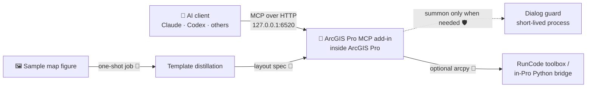

[](README.md) [](README.zh-CN.md) [](LICENSE) [](https://www.esri.com/en-us/arcgis/products/arcgis-pro/overview) []()

# 🗺️ ArcGIS Pro MCP · AgentKit ⚡

**One repo, three parts — your AI copilot finally gets hands on the map you already have open (｀・ω・´)ゞ**

No file juggling, no "export → upload → download" ritual. Your assistant talks to the ArcGIS Pro session right in front of you: your data, your maps, your layouts. 🔒 Everything stays on `127.0.0.1`.

> ### 🙏 Upstream project & original author
> This project stands on the shoulders of **[Knight60/ArcGIS-Pro-MCP](https://github.com/Knight60/ArcGIS-Pro-MCP)**,
> originally created by **Pisut Nakmuenwai**, licensed **AGPL-3.0-or-later**. Huge thanks! 🌟
> We carry local patches up to **v1.1.4** and add the guard/distill modules; upstream attribution lives in [NOTICE](NOTICE) and the source snapshot.

---

## ✨ What it is

Say it in plain language — *"color the counties by area, pastel red to green"* — and watch the map change. 🎨

| | Part | What it does | Status |
|---|---|---|---|
| 🧩 | **MCP** | ArcGIS Pro add-in: 113 native tools (in-process, ~9 ms ⚡), every geoprocessing tool, optional arcpy via RunCode / Python bridge. Listens on `127.0.0.1:6520/mcp`. | **Customer-ready v1.1.4** on [`customer-v1.1.4`](../../tree/customer-v1.1.4) 🎁 |
| 🛡️ | **Guard** | On-demand dialog guard for the "third-party code library" trust dialog. Summoned only when needed, gone right after. 🥷 | Skeleton — see [design](docs/design-2026-11-16.md) §3 |
| 🧪 | **Distill** | On-demand template distillation: sample figure → reusable layout spec. One shot, no daemon, fully repeatable. 🧬 | Skeleton — see [design](docs/design-2026-11-16.md) §4 |

### 🧠 Why "on demand"? (Because nobody loves zombie processes 🧟)

- 🥷 **Zero residents.** No risky operation, no guard process, no polling — the task manager stays boring.
- 🛡️ **The guard lives for exactly one operation.** Summoned before the trust dialog might appear, dismissed right after the operation settles. Auto-click success = you never notice ✨; failure = topmost alert (≥30 s, audible) 🚨. It only ever clicks the third-party-code trust dialog — overwrite/delete confirmations? Never. 🙅
- 🧪 **Distillation is a one-shot job.** No inbox watcher, no service. Run it when you need it; every step is idempotent and resumable. ✅



---

## 🚀 Quick start — customer edition (v1.1.4)

Everything is packed, batteries included 🔋 — add-in, stdio bridge, RunCode, dialog guard, Python bridge, installers, docs, and the full AGPL source snapshot:

- 👀 Browse: [**`customer-v1.1.4`**](../../tree/customer-v1.1.4)
- 📦 Download: [**ZIP archive**](https://github.com/XNYGggg/arcgis-pro-mcp-optimized/archive/refs/heads/customer-v1.1.4.zip)

1. 📂 Unzip anywhere → double-click `install/00-install.cmd` (no admin needed; ArcGIS Pro **3.7+** required).
2. 🖥️ Open ArcGIS Pro → trust the unsigned add-in when asked (say **Yes** 😄) → confirm the **MCP** tab shows **running** (port `127.0.0.1:6520`).
3. 🔌 Connect your AI client (table below).
4. ✅ Run `install/01-check.cmd` — all `[OK]` and you're golden (๑•̀ㅂ•́)و✧

No Python 🐍, no pip 📦, no internet 🌐 required: the add-in runs on the .NET runtime shipped with ArcGIS Pro 3.7+, and the bridge/guard use Windows' own PowerShell. `SHA256SUMS.txt` covers every single file. 🔐

### 🔌 Connect an AI client

| Client | How |
|---|---|
| 🟣 **Claude Code** | `claude mcp add --transport http arcgis http://127.0.0.1:6520/mcp` |
| 🖥️ **Claude Desktop** | Run `install/02-configure-claude.cmd` (after fully quitting the app) — it writes and backs up the config for you |
| 🟢 **Codex** | Add `[mcp_servers.arcgis]` + `url = "http://127.0.0.1:6520/mcp"` to `~/.codex/config.toml` |
| 🔧 **Other MCP clients** | Streamable HTTP to `http://127.0.0.1:6520/mcp` |

---

## 🗂️ Repository layout

```
├── main (this branch) 🏠      project skeleton: guard + distill modules, design docs
├── customer-v1.1.4 🎁         ready-to-use package (add-in 1.1.4 + everything above)
├── src/arcgis_agentkit/ 🧰    guard / distill Python packages (CLI skeletons)
├── skills/ 🎓                 assistant-facing skills (template-distill, arcgis-pro-mapping)
├── library/ 📚                template library schema (v1) and examples
├── docs/ 📖                   design & architecture notes
└── tests/ 🧪                  pytest smoke tests
```

Development install:

```powershell
python -m pip install -e .
arcgis-guard doctor
arcgis-distill doctor
```

## 🛣️ Roadmap — next stop, greatness 🚌💨

1. 🛡️ **M1 — Guard v1**: summon protocol, event-first UIA detection, add-in auto-arm around `run_python_toolbox_tool`, Pester tests.
2. 🧪 **M2 — Distill v1**: import / measure / validate / preview / library, `template-distill` skill, template MCP tools.
3. 🎉 **M3 — Open-source release**: versioning, bilingual docs, CI, release assets, clean-machine walkthrough.

Details, acceptance criteria and trade-offs: [docs/design-2026-11-16.md](docs/design-2026-11-16.md). 别催,在做了 (｀・ω・´)ゞ

---

## 📜 License, credits & disclaimer

- ⚖️ **License**: [AGPL-3.0-or-later](LICENSE). The MCP module derives from an AGPL-3.0-or-later project, so the combined repo is AGPL too.
- 🙏 **Upstream project & original author**: [Knight60/ArcGIS-Pro-MCP](https://github.com/Knight60/ArcGIS-Pro-MCP) by **Pisut Nakmuenwai** — thank you! 💐 Local modifications are declared in [NOTICE](NOTICE), [RELEASE-NOTES.md](https://github.com/XNYGggg/arcgis-pro-mcp-optimized/blob/customer-v1.1.4/RELEASE-NOTES.md), and `source/SOURCE-NOTICE.md` in the customer package.
- 🏷️ **Trademark**: not affiliated with Esri. "ArcGIS" is a trademark of Esri. Third-party tool, no strings attached.
- 🔒 **Privacy / network**: all services bind to `127.0.0.1` only; zero telemetry, zero cloud calls.
- 👤 **Maintainer**: Law ([@XNYGggg](https://github.com/XNYGggg)).

[🇨🇳 简体中文说明](README.zh-CN.md) · Made with ☕ + 🗺️ + 一点点强迫症
