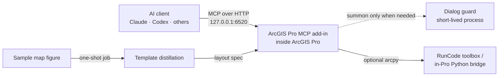

[](README.md) [](README.zh-CN.md) [](LICENSE) [](https://www.esri.com/en-us/arcgis/products/arcgis-pro/overview) []()

# ArcGIS Pro MCP · 优化版（AgentKit）

**An optimized, open-source ArcGIS Pro MCP distribution — one repository, three parts: the MCP add-in, an on-demand dialog guard, and on-demand template distillation.**

> ### Upstream project & original author
> The MCP module is built on **[Knight60/ArcGIS-Pro-MCP](https://github.com/Knight60/ArcGIS-Pro-MCP)**,
> originally created by **Pisut Nakmuenwai**, and licensed under **AGPL-3.0-or-later**.
> This project carries local patches up to **v1.1.4** and adds the guard/distill modules.
> Upstream attribution is preserved in [NOTICE](NOTICE) and in the source snapshot shipped with the customer package.

---

## What it is

Let an AI assistant (Claude, Codex, or any MCP client) work on the ArcGIS Pro project already open in front of you — your data, your maps, your layouts. No copies, no exports, no cloud round-trip.

| | Part | What it does | Status |
|---|---|---|---|
| **A** | **MCP** | ArcGIS Pro add-in: 113 native tools (in-process, ~9 ms), every geoprocessing tool, optional arcpy via RunCode / Python bridge. Listens on `127.0.0.1:6520/mcp`. | **Customer-ready v1.1.4** on the [`customer-v1.1.4`](../../tree/customer-v1.1.4) branch |
| **B** | **Guard** | On-demand dialog guard for ArcGIS Pro's "third-party code library" trust dialog. Nothing runs in the background; the guard is summoned only when an operation may raise the dialog, then exits. | Skeleton — design in [docs/design-2026-11-16.md](docs/design-2026-11-16.md) §3 |
| **C** | **Distill** | On-demand template distillation. Turn a sample map figure into a reusable layout spec: deterministic measurement, assistant-guided semantic pass, validation, preview, review — one job, no daemon. | Skeleton — design in [docs/design-2026-11-16.md](docs/design-2026-11-16.md) §4 |

### Why "on demand"

- **No resident processes.** When no risky operation is running, there is no guard process and no watcher polling in the background.
- **The guard lives for one operation.** It is summoned right before an operation that may trigger the trust dialog, and exits after the operation settles. Auto-click success is invisible; only a failure raises the topmost alert window (≥30 s, audible). It only ever clicks the third-party-code trust dialog — never overwrite/delete confirmations.
- **Distillation is a one-shot job.** No inbox watcher, no service. You run it when you need it; every step is idempotent and resumable.



---

## Quick start — customer edition (v1.1.4)

The ready-to-use package — add-in, stdio bridge, RunCode, dialog guard, Python bridge, installers, docs, and the full AGPL source snapshot — is published on its own branch:

- Browse: [**`customer-v1.1.4`**](../../tree/customer-v1.1.4)
- Download: [**ZIP archive**](https://github.com/XNYGggg/arcgis-pro-mcp-optimized/archive/refs/heads/customer-v1.1.4.zip)

1. Unzip anywhere and run `install/00-install.cmd` (no administrator rights needed; requires ArcGIS Pro **3.7+**).
2. Open ArcGIS Pro; when asked to trust the unsigned add-in, choose **Yes**. Confirm the **MCP** tab shows **running** (port `127.0.0.1:6520`).
3. Connect your AI client (see below).
4. Run `install/01-check.cmd` — all items `[OK]` means you are ready.

Nothing needs Python, pip, or an internet connection: the add-in runs on the .NET runtime that ships with ArcGIS Pro 3.7+, and the stdio bridge and guard use the PowerShell that ships with Windows. The package's `SHA256SUMS.txt` covers every file.

### Connect an AI client

| Client | How |
|---|---|
| **Claude Code** | `claude mcp add --transport http arcgis http://127.0.0.1:6520/mcp` |
| **Claude Desktop** | Run `install/02-configure-claude.cmd` (after fully quitting the app); it writes and backs up the config for you |
| **Codex** | Add `[mcp_servers.arcgis]` + `url = "http://127.0.0.1:6520/mcp"` to `~/.codex/config.toml` |
| **Other MCP clients** | Streamable HTTP to `http://127.0.0.1:6520/mcp` |

---

## Repository layout

```
├── main (this branch)         project skeleton: guard + distill modules, design docs
├── customer-v1.1.4            ready-to-use package (add-in 1.1.4 + everything above)
├── src/arcgis_agentkit/       guard / distill Python packages (CLI skeletons)
├── skills/                    assistant-facing skills (template-distill, arcgis-pro-mapping)
├── library/                   template library schema (v1) and examples
├── docs/                      design & architecture notes
└── tests/                     pytest smoke tests
```

Development install:

```powershell
python -m pip install -e .
arcgis-guard doctor
arcgis-distill doctor
```

## Roadmap

1. **M1 — Guard v1**: summon protocol, event-first UIA detection, add-in auto-arm around `run_python_toolbox_tool`, Pester tests.
2. **M2 — Distill v1**: import / measure / validate / preview / library, `template-distill` skill, template MCP tools.
3. **M3 — Open-source release**: versioning, bilingual docs, CI, release assets, clean-machine walkthrough.

Details, acceptance criteria and trade-offs: [docs/design-2026-11-16.md](docs/design-2026-11-16.md).

---

## License, credits & disclaimer

- **License**: [AGPL-3.0-or-later](LICENSE). Because the MCP module is derived from an AGPL-3.0-or-later project, the combined repository is AGPL-3.0-or-later as well.
- **Upstream project & original author**: [Knight60/ArcGIS-Pro-MCP](https://github.com/Knight60/ArcGIS-Pro-MCP) by **Pisut Nakmuenwai** — thank you. Local modifications are declared in [NOTICE](NOTICE), [RELEASE-NOTES.md](https://github.com/XNYGggg/arcgis-pro-mcp-optimized/blob/customer-v1.1.4/RELEASE-NOTES.md), and the source snapshot (`source/SOURCE-NOTICE.md` in the customer package).
- **Trademark**: not affiliated with Esri. "ArcGIS" is a trademark of Esri. This is a third-party tool.
- **Privacy / network**: all services bind to `127.0.0.1` only; no telemetry, no cloud calls.
- **Maintainer**: 柳皓文 ([@XNYGggg](https://github.com/XNYGggg)).

[简体中文说明](README.zh-CN.md)
