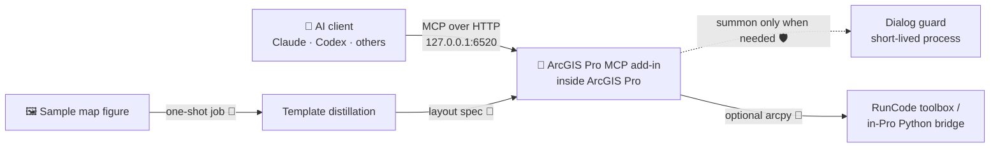

[](README.md) [](README.zh-CN.md) [](LICENSE) [](https://www.esri.com/en-us/arcgis/products/arcgis-pro/overview) []()

# 🗺️ ArcGIS Pro MCP · AgentKit ⚡

**One repo, three parts — your AI copilot finally gets hands on the map you already have open (｀・ω・´)ゞ**

No file juggling, no "export → upload → download" ritual. Your assistant talks to the ArcGIS Pro session right in front of you: your data, your maps, your layouts. 🔒 Everything stays on `127.0.0.1`.

> ### 🙏 Upstream project & original author
> This project stands on the shoulders of **[Knight60/ArcGIS-Pro-MCP](https://github.com/Knight60/ArcGIS-Pro-MCP)**,
> originally created by **Pisut Nakmuenwai**, licensed **AGPL-3.0-or-later**. Huge thanks! 🌟
> We carry local patches up to **v1.1.4** and add the guard/distill modules; upstream attribution lives in [NOTICE](NOTICE) and the source snapshot.

---

## ✨ What it is

Say it in plain language — *"color the counties by area, pastel red to green"* — and watch the map change. 🎨

| | Part | What it does | Status |
|---|---|---|---|
| 🧩 | **MCP** | ArcGIS Pro add-in: **113 native tools** (in-process, ~9 ms ⚡), every geoprocessing tool, optional arcpy via RunCode / Python bridge. Listens on `127.0.0.1:6520/mcp`. | **Customer-ready v1.1.4** on [`customer-v1.1.4`](../../tree/customer-v1.1.4) 🎁 |
| 🛡️ | **Guard** | On-demand dialog guard for the "third-party code library" trust dialog. Summoned only when needed, gone right after. 🥷 | Skeleton — see [design](docs/design-2026-11-16.md) §3 |
| 🧪 | **Distill** | On-demand template distillation: sample figure → reusable layout spec. One shot, no daemon, fully repeatable. 🧬 | Skeleton — see [design](docs/design-2026-11-16.md) §4 |

### 🧠 Why "on demand"? (Because nobody loves zombie processes 🧟)

- 🥷 **Zero residents.** No risky operation, no guard process, no polling — the task manager stays boring.
- 🛡️ **The guard lives for exactly one operation.** Summoned before the trust dialog might appear, dismissed right after the operation settles. Auto-click success = you never notice ✨; failure = topmost alert (≥30 s, audible) 🚨. It only ever clicks the third-party-code trust dialog — overwrite/delete confirmations? Never. 🙅
- 🧪 **Distillation is a one-shot job.** No inbox watcher, no service. Run it when you need it; every step is idempotent and resumable. ✅



---

## 🚀 Quick start — customer edition (v1.1.4)

Everything is packed, batteries included 🔋 — add-in, stdio bridge, RunCode, dialog guard, Python bridge, installers, docs, and the full AGPL source snapshot:

- 👀 Browse: [**`customer-v1.1.4`**](../../tree/customer-v1.1.4)
- 📦 Download: [**ZIP archive**](https://github.com/XNYGggg/arcgis-pro-mcp-optimized/archive/refs/heads/customer-v1.1.4.zip)

1. 📂 Unzip anywhere → double-click `install/00-install.cmd` (no admin needed; ArcGIS Pro **3.7+** required).
2. 🖥️ Open ArcGIS Pro → trust the unsigned add-in when asked (say **Yes** 😄) → confirm the **MCP** tab shows **running** (port `127.0.0.1:6520`).
3. 🔌 Connect your AI client (see the configuration section below).
4. ✅ Run `install/01-check.cmd` — all `[OK]` and you're golden (๑•̀ㅂ•́)و✧

No Python 🐍, no pip 📦, no internet 🌐 required: the add-in runs on the .NET runtime shipped with ArcGIS Pro 3.7+, and the bridge/guard use Windows' own PowerShell. `SHA256SUMS.txt` covers every single file. 🔐

---

## 🎛️ Configuration — connect your AI client

**Prerequisites:** ArcGIS Pro is open and the **MCP** tab shows **running**. All ports are loopback-only:

| Port | Purpose |
|---|---|
| `6520` | MCP over HTTP — every AI client connects here |
| `6510` | Legacy TCP bridge (not used by today's clients) |
| `6511` | Optional in-Pro Python bridge (`execute_arcpy_code`) |

### 🟣 Claude Code

```powershell
claude mcp add --transport http arcgis http://127.0.0.1:6520/mcp
claude mcp list
```

Manual equivalent in `~/.claude.json`:

```json
{ "mcpServers": { "arcgis": { "type": "http", "url": "http://127.0.0.1:6520/mcp" } } }
```

Remove with `claude mcp remove arcgis`; re-add with the same command.

### 🖥️ Claude Desktop (bundled stdio bridge)

Claude Desktop cannot dial out to an HTTP server — it launches local processes. Use the bundled PowerShell bridge (no Python needed):

1. **Quit Claude Desktop completely** (tray icon included).
2. Run `install/02-configure-claude.cmd`, or edit the config by hand (it backs up the file for you).
3. Config lives in the first of these folders that exists:
   `%APPDATA%\Claude`, `%APPDATA%\Claude-3p`, `%LOCALAPPDATA%\Claude-3p`, `%LOCALAPPDATA%\Claude` — file `claude_desktop_config.json`.

```json
{
  "mcpServers": {
    "arcgis": {
      "command": "C:\\Windows\\System32\\WindowsPowerShell\\v1.0\\powershell.exe",
      "args": ["-NoProfile", "-ExecutionPolicy", "Bypass", "-File",
               "C:\\Users\\<you>\\AppData\\Local\\ArcGIS Pro MCP\\stdio-bridge.ps1"]
    }
  }
}
```

4. Reopen Claude Desktop — `arcgis` appears in the tools list.

### 🟢 Codex

Add to `~/.codex/config.toml` (replace any older `arcgis` section):

```toml
[mcp_servers.arcgis]
url = "http://127.0.0.1:6520/mcp"
```

Restart Codex.

### 🔧 Other MCP clients

Use Streamable HTTP to `http://127.0.0.1:6520/mcp`; or the generic JSON above. (Antigravity wants `serverUrl` and no `type`.)

### ✅ Verify the connection

- `install/01-check.cmd` — checks Pro version, add-in hash, runtime, ports, client configs.
- `netstat -ano | findstr 6520` — confirm the port is listening.
- Logs: `%LOCALAPPDATA%\ArcGIS-MCP\addin.log`.

---

## 🎯 How to use it

**The loop:** open a project with data → say what you want → the assistant picks the right tools → check the result (images come back inline). 🎨

| Say this | What happens |
|---|---|
| “Color the counties by area, pastel red to green” | `set_layer_renderer` (graduated colors) |
| “Select the counties with population > 500,000 and export them” | `select_features` → `export_features` |
| “Buffer the roads by 500 m” | `run_geoprocessing_tool` (Buffer) |
| “How much cropland is in each township?” | `summarize_features` / `zonal_statistics` |
| “Show me the current map view” | `export_map_view` (returns PNG) |
| “Make an A3 portrait PDF with title, legend, scale bar, north arrow” | `create_layout` → `add_map_frame` → `add_layout_*` → `export_layout` |
| “Export all 12 layers with the same symbology” | `run_batch` or `execute_arcpy_code` |

**Tool-level usage.** Every tool in the catalog below is callable by name from the client. `run_batch` chains many commands in one round trip; `execute_arcpy_code` is the universal escape hatch when no dedicated tool covers the task.

**Editing rules.** Edits stay pending until `save_edits` — pending edits lock the data, so deleting or overwriting the dataset fails until you save. `discard_edits` throws them away. `delete_features` / `delete_dataset` cannot be undone: ask the assistant to state the scope first.

**Optional components on demand.**
- 🐍 RunCode toolbox: `%LOCALAPPDATA%\ArcGIS Pro MCP\runcode\RunCode.pyt` — first run per Pro session raises the trust dialog; start the guard first.
- 🔌 Python bridge: paste into Pro's Python window (`sys.path.insert(0, r"...\ArcGIS Pro MCP\plugin")`, then `mcp_bridge.start_server(port=6511)`); add `mcp_bridge.start_pump()` for `CURRENT`.
- 🛡️ Dialog guard: `install\03-dialog-guard.cmd` (600 s), `-AlertOnly`, `-NotifyTest`.

---

## 🧰 All 113 MCP tools (12 groups)

Everything the assistant can do, by name. Click to expand 👇

<details>
<summary><b>📜 Full tool catalog — Session 15 · Layers 19 · Data 11 · Selection 6 · Schema 11 · Geoprocessing 7 · Symbology 6 · View 7 · Layouts 16 · Raster 5 · Catalog 6 · Utility 4</b></summary>

### Session (15)

| Tool | What it does |
|---|---|
| `ping` | Check that the ArcGIS Pro bridge is reachable and see which project it is attached to. |
| `get_capabilities` | List every command the connected bridge supports, grouped by area. Use this to discover functionality beyond the named tools. |
| `get_queue_status` | Queue status for the bridge: per-lane depth, the command running now, and recent completion history. Check it when calls feel slow, are queued, or fail with a 'lane busy' error. |
| `diagnose` | Self-check the connection: ArcGIS Pro version, licence, open project, active map, open map view and write access. Run this first when something does not work. |
| `get_arcgis_info` | ArcGIS Pro version, licence level, available extensions and the current project path. |
| `get_project_info` | Project paths, default geodatabase and toolbox, maps, layouts, folder and database connections. |
| `save_project` | Save the ArcGIS Pro project (.aprx), or save a copy elsewhere. |
| `list_maps` | List all maps and scenes with coordinate system and layer counts. |
| `create_map` | Create a new map or scene in the project. |
| `remove_map` | Delete a map from the project. |
| `activate_map` | Open/activate a map's view in the ArcGIS Pro UI. Needed before camera commands and export_map_view. |
| `set_map_properties` | Rename a map or change its coordinate system. |
| `get_map_extent` | The combined extent of all data layers in a map. |
| `get_environment` | Read the current arcpy geoprocessing environment settings. |
| `set_environment` | Set arcpy geoprocessing environment settings such as workspace, outputCoordinateSystem, extent, mask, cellSize, overwriteOutput or parallelProcessingFactor. |

### Layers (19)

| Tool | What it does |
|---|---|
| `get_layers` | List the layers (with draw order and group nesting) and standalone tables in a map. Start here to see what is in the project. |
| `get_layer_info` | Full detail for one layer: data source, coordinate system, extent, fields, feature count, renderer and label state. |
| `add_layer` | Add data to a map from a path or service URL: feature class, shapefile, raster, table, .lyrx layer file or web service. |
| `add_web_layer` | Add a web service layer (Feature/Map/Image service, WMS, WMTS, vector tile) by URL. |
| `remove_layer` | Remove a layer or standalone table from a map. |
| `rename_layer` | Rename a layer in the table of contents. |
| `duplicate_layer` | Copy a layer within the map so it can be symbolised differently. |
| `set_layer_visibility` | Show or hide one layer, several layers, or every layer in the map. |
| `set_layer_transparency` | Set layer transparency (0 = opaque, 100 = fully transparent). |
| `set_layer_scale_range` | Limit the scale range a layer draws at. |
| `set_definition_query` | Set a layer's definition query (SQL where clause). Empty string clears it. |
| `move_layer` | Reorder a layer relative to another, or move it into a group layer. |
| `create_group_layer` | Create a group layer, optionally moving existing layers into it. |
| `zoom_to_layer` | Zoom the map view to a layer's extent. |
| `set_basemap` | Set the basemap: Topographic, Imagery, Imagery Hybrid, Streets, Navigation, Light Gray Canvas, Dark Gray Canvas, Terrain, Oceans, OpenStreetMap, National Geographic Style Map. |
| `get_broken_layers` | List layers across all maps whose data source is missing. |
| `repair_layer_source` | Repoint a layer at a new workspace or dataset to fix a broken source. |
| `add_join` | Join a table to a layer on a common field. |
| `remove_join` | Remove a join from a layer. |

### Data (11)

| Tool | What it does |
|---|---|
| `get_features` | Read attribute rows from a layer, table or dataset path, with an optional where clause, field subset, ordering and WKT geometry. |
| `count_features` | Count features, optionally matching a where clause. |
| `get_unique_values` | Distinct values of a field with the count of rows for each. |
| `get_field_statistics` | min / max / mean / median / sum / standard deviation of a numeric field. |
| `summarize_features` | Group rows by one or more fields and aggregate -- the fast way to answer 'how many / how much per category' without geoprocessing. |
| `insert_features` | Insert new rows into a layer or table. |
| `update_features` | Update attributes and/or geometry of rows matching a where clause. |
| `delete_features` | Delete rows matching a where clause. |
| `save_edits` | Commit pending edits. ArcGIS Pro keeps edits open so they can be undone, which also leaves the data locked until they are saved -- deleting or overwriting an edited dataset fails until then. |
| `discard_edits` | Throw away pending edits. |
| `calculate_field` | Calculate field values across a layer, e.g. expression "!Shape_Area! / 10000". |

### Selection (6)

| Tool | What it does |
|---|---|
| `select_features` | Select features by SQL where clause. |
| `select_by_location` | Select features by spatial relationship to another layer. |
| `get_selection` | Report what is currently selected, per layer, with ObjectIDs and optionally the attribute rows. |
| `set_selection` | Select specific features by ObjectID. |
| `clear_selection` | Clear the selection on one layer, or on every layer in the map. |
| `zoom_to_selection` | Zoom the map view to the currently selected features. |

### Schema (11)

| Tool | What it does |
|---|---|
| `list_fields` | List a layer's fields with type, alias, length and domain. |
| `add_field` | Add a field to a layer or table. |
| `add_fields` | Add several fields in one call. |
| `delete_field` | Delete one or more fields. |
| `alter_field` | Rename a field or change its alias/length. |
| `create_feature_class` | Create an empty feature class, by default in the project's default geodatabase, and add it to the map. |
| `create_table` | Create an empty standalone table. |
| `create_file_geodatabase` | Create a new file geodatabase. |
| `truncate_table` | Delete every row from a table or feature class, keeping the schema. |
| `delete_dataset` | Delete a dataset from disk or a geodatabase. This cannot be undone. |
| `export_features` | Export a layer -- honouring its current selection and definition query -- to a new dataset. |

### Geoprocessing (7)

| Tool | What it does |
|---|---|
| `run_geoprocessing_tool` | Run any arcpy geoprocessing tool -- the universal escape hatch for analysis. Layer names resolve to live layers so selections and definition queries apply. Call describe_geoprocessing_tool first if the parameter names are not known. |
| `list_geoprocessing_tools` | Search the available geoprocessing tools by name. |
| `list_toolboxes` | List the arcpy toolbox modules and any toolboxes in the project. |
| `describe_geoprocessing_tool` | Get a tool's parameters, data types, defaults and usage text before running it. |
| `run_python_toolbox_tool` | Run a tool from a custom .pyt / .atbx / .tbx toolbox on disk. |
| `check_extension` | Check, and optionally check out, an ArcGIS extension licence. |
| `get_messages` | Messages from the most recent geoprocessing operation. |

### Symbology (6)

| Tool | What it does |
|---|---|
| `set_layer_renderer` | Change a layer's symbology: a single symbol, unique values by category, or a classified/continuous colour scheme by numeric field. |
| `get_layer_symbology` | Inspect a layer's current renderer, class breaks, unique values and label settings. |
| `list_color_ramps` | List the colour ramps available in the project. |
| `set_layer_labeling` | Turn labels on or off and set the expression, font and halo. |
| `apply_symbology_from_layer` | Copy symbology from a .lyrx file or another layer. |
| `save_layer_file` | Save a layer with its symbology to a .lyrx file for reuse. |

### View (7)

| Tool | What it does |
|---|---|
| `get_map_view` | Current camera position: centre, scale, rotation and visible extent. Requires the map's tab to be open in ArcGIS Pro. |
| `set_map_view` | Move the map view: set an extent, a centre point, a scale and/or a rotation. |
| `export_map_view` | Render the map view to PNG and return the image so it can be looked at -- the way to visually check a map. Requires the map's tab to be open in ArcGIS Pro. |
| `list_bookmarks` | List the spatial bookmarks defined on a map. |
| `create_bookmark` | Save the current view, or a given extent, as a named bookmark. |
| `apply_bookmark` | Zoom the map view to a bookmark. |
| `delete_bookmark` | Delete a bookmark from a map. |

### Layouts (16)

| Tool | What it does |
|---|---|
| `list_layouts` | List the print layouts with page size and element counts. |
| `get_layout_info` | Inspect a layout: page setup and every element with position and size. |
| `create_layout` | Create a new layout page, by default with a map frame filling it. |
| `delete_layout` | Delete a layout from the project. |
| `add_map_frame` | Add a map frame to a layout at a page position. |
| `set_map_frame_extent` | Point a layout's map frame at a layer, an extent or a scale. |
| `add_layout_text` | Add a text element such as a title or credits to a layout. |
| `add_layout_legend` | Add a legend tied to a layout's map frame. |
| `add_layout_scale_bar` | Add a scale bar tied to a layout's map frame. |
| `add_layout_north_arrow` | Add a north arrow tied to a layout's map frame. |
| `add_layout_picture` | Place an image such as a logo on a layout. |
| `set_layout_element` | Move, resize, rename, hide or change the text of any layout element. |
| `delete_layout_element` | Remove an element from a layout. |
| `export_layout` | Export a layout to PDF / PNG / JPEG / SVG / TIFF. PNG and JPEG come back as an inline image so the result can be checked. |
| `preview_layout` | Render a layout to a temporary image and return it, without writing a file -- use it to visually check a layout while building it. |
| `export_map_series` | Export a layout's map series (map book) to a multi-page PDF. |

### Raster (5)

| Tool | What it does |
|---|---|
| `get_raster_info` | Raster detail: bands, size, cell size, pixel type, statistics and CRS. |
| `set_raster_symbology` | Set a raster layer's colorizer and colour ramp. |
| `raster_calculator` | Map algebra. Bind rasters to short names, then write a Python expression over them. Requires the Spatial Analyst extension. |
| `sample_raster_values` | Read raster cell values at map coordinates or at a point layer's features. |
| `zonal_statistics` | Summarise raster values inside zone polygons and return the table. Requires the Spatial Analyst extension. |

### Catalog (6)

| Tool | What it does |
|---|---|
| `list_workspace_contents` | List the datasets inside a geodatabase or folder. Defaults to the project's default geodatabase. |
| `list_folder` | List GIS files and subfolders on disk. Defaults to the project home folder. |
| `describe_dataset` | Describe any dataset by path -- type, geometry, CRS, extent, fields and row count -- without adding it to a map. |
| `search_data` | Find datasets by name across the project's geodatabase, home folder and folder connections. The quickest way to locate data before adding it. |
| `get_project_items` | Folder connections, database connections and toolboxes registered in the project. |
| `add_folder_connection` | Register a folder with the project so its data is easy to browse. |

### Utility (4)

| Tool | What it does |
|---|---|
| `execute_arcpy_code` | Run Python inside ArcGIS Pro. arcpy is already imported and arcpy.mp.ArcGISProject('CURRENT') is the open project. Variables persist between calls, print() output is captured, and the value of a final expression is returned. Use this whenever no dedicated tool covers the task. |
| `get_pump_status` | Whether the main-thread dispatcher is installed. It is what lets commands reach the open ArcGIS Pro project; without it only path-based work (geoprocessing, dataset inspection) runs. |
| `stop_pump` | Remove the main-thread dispatcher. Live-project commands stop working until the user installs it again. |
| `run_batch` | Run several commands in one round trip -- much faster for multi-step workflows. |

</details>

---

## 🗂️ Repository layout

```
├── main (this branch) 🏠      project skeleton: guard + distill modules, design docs
├── customer-v1.1.4 🎁         ready-to-use package (add-in 1.1.4 + everything above)
├── src/arcgis_agentkit/ 🧰    guard / distill Python packages (CLI skeletons)
├── skills/ 🎓                 assistant-facing skills (template-distill, arcgis-pro-mapping)
├── library/ 📚                template library schema (v1) and examples
├── docs/ 📖                   design & architecture notes
└── tests/ 🧪                  pytest smoke tests
```

Development install:

```powershell
python -m pip install -e .
arcgis-guard doctor
arcgis-distill doctor
```

## 🛣️ Roadmap — next stop, greatness 🚌💨

1. 🛡️ **M1 — Guard v1**: summon protocol, event-first UIA detection, add-in auto-arm around `run_python_toolbox_tool`, Pester tests.
2. 🧪 **M2 — Distill v1**: import / measure / validate / preview / library, `template-distill` skill, template MCP tools.
3. 🎉 **M3 — Open-source release**: versioning, bilingual docs, CI, release assets, clean-machine walkthrough.

Details, acceptance criteria and trade-offs: [docs/design-2026-11-16.md](docs/design-2026-11-16.md). 别催,在做了 (｀・ω・´)ゞ

---

## 📜 License, credits & disclaimer

- ⚖️ **License**: [AGPL-3.0-or-later](LICENSE). The MCP module derives from an AGPL-3.0-or-later project, so the combined repo is AGPL too.
- 🙏 **Upstream project & original author**: [Knight60/ArcGIS-Pro-MCP](https://github.com/Knight60/ArcGIS-Pro-MCP) by **Pisut Nakmuenwai** — thank you! 💐 Local modifications are declared in [NOTICE](NOTICE), [RELEASE-NOTES.md](https://github.com/XNYGggg/arcgis-pro-mcp-optimized/blob/customer-v1.1.4/RELEASE-NOTES.md), and `source/SOURCE-NOTICE.md` in the customer package.
- 🏷️ **Trademark**: not affiliated with Esri. "ArcGIS" is a trademark of Esri. Third-party tool, no strings attached.
- 🔒 **Privacy / network**: all services bind to `127.0.0.1` only; zero telemetry, zero cloud calls.
- 👤 **Maintainer**: Law ([@XNYGggg](https://github.com/XNYGggg)).

[🇨🇳 简体中文说明](README.zh-CN.md) · Made with ☕ + 🗺️ + 一点点强迫症
