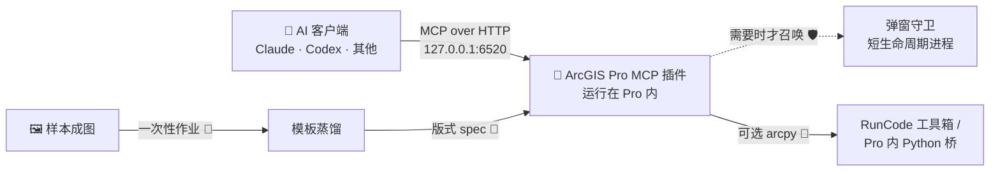

[](README.md) [](README.zh-CN.md) [](LICENSE) [](https://www.esri.com/en-us/arcgis/products/arcgis-pro/overview) []() [](../../releases)

# 🗺️ ArcGIS Pro MCP · 优化版（AgentKit）⚡

**一个仓库、三部分——让你的 AI 助手直接上手你正开着的 ArcGIS Pro 工程 (｀・ω・´)ゞ**

告别"导出 → 上传 → 下载"的往返折腾 🏃‍♂️💨。助手直接跟你眼前的 Pro 会话对话:你的数据、你的地图、你的布局。🔒 所有通信只走 `127.0.0.1`,数据不出本机。

> **📌 版本说明（2026-11-16）**：**1.0 版本（[v1.1.4](../../releases/tag/v1.1.4)）非常稳定，推荐日常使用**；**2.0 版本（v2.0.0）现在正在测试阶段**，尚未完成优化，暂不推荐用于正式工作——稳定版请从 [Release v1.1.4](../../releases/tag/v1.1.4) 下载。

> ### 🙏 上游项目与原作者
> 本项目站在巨人的肩膀上:**[Knight60/ArcGIS-Pro-MCP](https://github.com/Knight60/ArcGIS-Pro-MCP)**,
> 原作者 **Pisut Nakmuenwai**,**AGPL-3.0-or-later** 许可。感谢原作者!🌟
> 我们在其基础上累计本地补丁至 **v2.0.0**,并新增守卫与蒸馏两个模块;上游署名与修改声明保留在 [NOTICE](NOTICE) 与客户包内的源码快照中。

---

## ✨ 这是什么

一句话就能改图——"按面积给区县做分级色彩,浅红到深绿"——然后看着地图自己变 🎨。

| | 模块 | 作用 | 状态 |
|---|---|---|---|
| 🧩 | **MCP** | ArcGIS Pro 插件:**125 个原生工具**(进程内执行,约 9 ms ⚡)、全部地理处理工具、可选 RunCode / Python 桥 arcpy 通道。监听 `127.0.0.1:6520/mcp`。 | **v2.0.0 测试中** 🧪 · 稳定版标记：v1.1.4 |
| 🛡️ | **Guard** | 按需弹窗守卫:只在可能触发"第三方代码库"信任框的操作前被召唤,操作结束立刻收队。🥷 | **已完成**——见 [guard.md](docs/guard.md) |
| 🧪 | **Distill** | 按需模板蒸馏:样本成图 → 可复用版式 spec。一次作业、无守护进程、完全可复现。🧬 | **已完成**——见 [distill.md](docs/distill.md) |

### 🧠 为什么强调"按需"?(因为没人喜欢打不死的小强进程 🧟)

- 🥷 **零常驻**:没有危险操作时,没有守卫进程、没有后台轮询——任务管理器安静得能听见风声 🍃。
- 🛡️ **守卫只活一次操作**:在信任框可能出现之前召唤,操作结束立即退出。自动点击成功 = 你完全无感 ✨;失败 = 置顶警报(≥30 秒、响铃)🚨。它只点"第三方代码库执行"信任框,覆盖/删除确认框?绝不碰 🙅。
- 🧪 **蒸馏是一次性作业**:不监听 inbox、不起服务,需要时才运行;每一步幂等、可断点续做 ✅。



---

## 🚀 快速开始 —— 客户版

目前有两个版本,除参与测试外请优先用稳定版:

- ✅ **稳定版 · 推荐**:[**Release v1.1.4**](../../releases/tag/v1.1.4) → `ArcGIS-Pro-MCP-v1.1.4.zip`——add-in 1.1.4、stdio 桥、RunCode、弹窗守卫、Python 桥、安装器、文档与 AGPL 源码快照,一个包全带走(包内每个文件都可用自带 `SHA256SUMS.txt` 校验)
- 🧪 **测试版 · 暂不推荐**:[**Release v2.0.0**](../../releases/tag/v2.0.0) → `ArcGIS-Pro-MCP-v2.0.0.zip`——add-in 2.0.0、新版按需守卫引擎与内置蒸馏运行时,仍在测试阶段
- 👀 浏览源码:[**`customer-v1.1.4`**](../../tree/customer-v1.1.4)(稳定)· [**`customer-v2.0.0`**](../../tree/customer-v2.0.0)(测试)
- 🛺 想一条命令装好?看下面的 NuGet 安装器 ⬇️

1. 📂 解压到任意目录 → 双击 `install/00-install.cmd`(不需要管理员;要求 ArcGIS Pro **3.7+**)
2. 🖥️ 打开 ArcGIS Pro → 首次加载未签名 add-in 时选"是/信任"(放心点 😄)→ 确认顶部 **MCP 选项卡** 显示 **running**(端口 `127.0.0.1:6520`)
3. 🔌 接入你的 AI 客户端(见下方"配置方法")
4. ✅ 运行 `install/01-check.cmd`,全部 `[OK]` 就大功告成 (๑•̀ㅂ•́)و✧

无需 Python 🐍、无需 pip 📦、无需联网 🌐:add-in 跑在 ArcGIS Pro 3.7+ 自带的 .NET 运行时上,stdio 桥与守卫用的是 Windows 自带的 PowerShell。包内 `SHA256SUMS.txt` 覆盖每一个文件 🔐。

### 🛺 通过 NuGet 一键安装(GitHub Packages)

不想手动解压?dotnet 工具 [`ArcGISProMCP.Install`](../../pkgs/nuget/ArcGISProMCP.Install) 会自动从 Releases 下载离线包、逐文件校验 `SHA256SUMS.txt` 后启动 `install/00-install.cmd`。需要 .NET SDK,以及带 `read:packages` 权限的 [PAT](https://github.com/settings/tokens):

```powershell
# 首次:注册 GitHub Packages 的 NuGet 源
dotnet nuget add source "https://nuget.pkg.github.com/XNYGggg/index.json" --name github --username XNYGggg --password <你的PAT> --store-password-in-clear-text

dotnet tool install --global ArcGISProMCP.Install --version 1.1.4   # 稳定版；v2.0.0 仍在测试
arcgis-pro-mcp-install              # 加 --dry-run 则只下载与校验,不启动安装
```

---

## 🎛️ 配置方法 —— 接入你的 AI 客户端

**前提**:ArcGIS Pro 已打开,**MCP 选项卡**显示 **running**。所有端口只绑定本机:

| 端口 | 用途 |
|---|---|
| `6520` | MCP over HTTP —— 所有 AI 客户端都连这里 |
| `6510` | 旧版 TCP 桥(现代客户端不用) |
| `6511` | 可选 Pro 内 Python 桥(`execute_arcpy_code`) |

### 🟣 Claude Code

```powershell
claude mcp add --transport http arcgis http://127.0.0.1:6520/mcp
claude mcp list
```

手工等价配置(`~/.claude.json`):

```json
{ "mcpServers": { "arcgis": { "type": "http", "url": "http://127.0.0.1:6520/mcp" } } }
```

移除用 `claude mcp remove arcgis`,再加回用上面的命令。

### 🖥️ Claude Desktop(使用自带的 stdio 桥)

Claude Desktop 不能直连 HTTP,只能启动本地进程——用包内纯 PowerShell 的桥(无需 Python):

1. **完全退出 Claude Desktop**(含托盘图标)。
2. 运行 `install/02-configure-claude.cmd`,或手工编辑配置(脚本/手工都请先备份)。
3. 配置文件位于以下目录中"已存在"的第一个:
   `%APPDATA%\Claude`、`%APPDATA%\Claude-3p`、`%LOCALAPPDATA%\Claude-3p`、`%LOCALAPPDATA%\Claude` —— 文件名 `claude_desktop_config.json`。

```json
{
  "mcpServers": {
    "arcgis": {
      "command": "C:\\Windows\\System32\\WindowsPowerShell\\v1.0\\powershell.exe",
      "args": ["-NoProfile", "-ExecutionPolicy", "Bypass", "-File",
               "C:\\Users\\<你的用户名>\\AppData\\Local\\ArcGIS Pro MCP\\stdio-bridge.ps1"]
    }
  }
}
```

4. 重新打开 Claude Desktop,工具列表里出现 `arcgis` 即成功。

### 🟢 Codex

在 `~/.codex/config.toml` 中加入(如已有旧 `arcgis` 段,整段替换,包括旧的 `env` 子表):

```toml
[mcp_servers.arcgis]
url = "http://127.0.0.1:6520/mcp"
```

保存后重启 Codex。

### 🔧 其他 MCP 客户端

以 Streamable HTTP 连接 `http://127.0.0.1:6520/mcp`,或用上面的通用 JSON。(Antigravity 用 `serverUrl` 且不要 `type`。)

### ✅ 验证连接

- `install/01-check.cmd` —— 检查 Pro 版本、add-in 哈希、运行时、端口与客户端配置。
- `netstat -ano | findstr 6520` —— 确认端口在监听。
- 日志:`%LOCALAPPDATA%\ArcGIS-MCP\addin.log`。

---

## 🎯 使用方法

**基本循环**:打开有数据的工程 → 说出你的需求 → 助手自动选择工具 → 查看结果(图片会直接内联返回)🎨

| 你可以说 | 实际发生什么 |
|---|---|
| "按面积给区县做分级色彩,浅红到深绿" | `set_layer_renderer`(分级色彩) |
| "选出人口大于 50 万的县并导出成新要素类" | `select_features` → `export_features` |
| "给道路做 500 米缓冲区" | `run_geoprocessing_tool`(Buffer) |
| "统计每个乡镇的耕地面积" | `summarize_features` / `zonal_statistics` |
| "把当前地图视图截给我看" | `export_map_view`(返回 PNG) |
| "出一张 A3 竖版 PDF,带标题、图例、比例尺、指北针" | `create_layout` → `add_map_frame` → `add_layout_*` → `export_layout` |
| "把 12 个图层按同一套符号批量导出" | `run_batch` 或 `execute_arcpy_code` |

**按工具名调用**:下表中的每个工具都可以被客户端按名字直接调用;`run_batch` 可在一次往返里串起多条命令;没有专用工具时用 `execute_arcpy_code` 兜底。

**编辑规则**:编辑在 `save_edits` 之前一直挂起,挂起期间数据被锁定(删除/覆盖会失败);`discard_edits` 丢弃挂起编辑。`delete_features` / `delete_dataset` 不可撤销——先让助手说明影响范围再执行。

**可选组件的按需用法:**
- 🐍 RunCode 工具箱:`%LOCALAPPDATA%\ArcGIS Pro MCP\runcode\RunCode.pyt`;每个 Pro 会话首次运行会弹信任框,可先启动弹窗守护。
- 🔌 Python 桥:在 Pro 的 Python 窗口粘贴 `sys.path.insert(0, r"...\ArcGIS Pro MCP\plugin")` 并执行 `mcp_bridge.start_server(port=6511)`;需要 `CURRENT` 时再加 `mcp_bridge.start_pump()`。
- 🛡️ 弹窗守护:`install\03-dialog-guard.cmd`(600 秒)、`-AlertOnly`、`-NotifyTest`。

---

## 🧰 全部 125 个 MCP 工具(14 组)

助手能做的全部事情,按名字列在这里。点开看看 👇

<details>
<summary><b>📜 完整工具清单 —— 会话 15 · 图层 19 · 数据 11 · 选择 6 · 字段/数据集 11 · 地理处理 7 · 符号化 6 · 视图 7 · 布局 16 · 栅格 5 · 目录 6 · 实用工具 4 · 守卫 2 · 模板 10</b></summary>

### 会话与工程（15）

| 工具 | 用途 |
|---|---|
| `ping` | 检查桥接连通性，并返回所连接的工程。 |
| `get_capabilities` | 列出桥接支持的全部命令（按领域分组），用于发现具名工具之外的能力。 |
| `get_queue_status` | 查看三车道队列状态：各车道深度、当前命令与最近完成记录；调用变慢或被排队时先看它。 |
| `diagnose` | 连接自检：Pro 版本、许可、打开的工程、活动地图、地图视图与写权限；出问题先跑它。 |
| `get_arcgis_info` | ArcGIS Pro 版本、许可级别、可用扩展与当前工程路径。 |
| `get_project_info` | 工程路径、默认地理数据库与工具箱、地图、布局、文件夹与数据库连接。 |
| `save_project` | 保存工程（.aprx），或另存副本到指定位置。 |
| `list_maps` | 列出所有地图与场景，含坐标系与图层数量。 |
| `create_map` | 在工程中新建地图或场景。 |
| `remove_map` | 从工程中删除地图。 |
| `activate_map` | 在 Pro 界面中打开/激活地图视图；相机类命令与 export_map_view 之前必需。 |
| `set_map_properties` | 重命名地图或修改其坐标系。 |
| `get_map_extent` | 地图中全部数据图层的合并范围。 |
| `get_environment` | 读取当前 arcpy 地理处理环境设置。 |
| `set_environment` | 设置 arcpy 环境（工作空间、输出坐标系、范围、掩膜、像元大小、覆盖输出、并行因子等）。 |

### 图层（19）

| 工具 | 用途 |
|---|---|
| `get_layers` | 列出地图中的图层（含绘制顺序与组嵌套）与独立表；了解工程内容从这里开始。 |
| `get_layer_info` | 单图层完整详情：数据源、坐标系、范围、字段、要素数、渲染器与标注状态。 |
| `add_layer` | 按路径或服务 URL 向地图添加数据：要素类、shapefile、栅格、表、.lyrx 图层文件或 Web 服务。 |
| `add_web_layer` | 按 URL 添加 Web 图层（Feature/Map/Image 服务、WMS、WMTS、矢量瓦片）。 |
| `remove_layer` | 从地图中移除图层或独立表。 |
| `rename_layer` | 重命名内容列表中的图层。 |
| `duplicate_layer` | 在地图内复制图层，便于用不同符号化展示。 |
| `set_layer_visibility` | 显示或隐藏单个、多个或地图中的全部图层。 |
| `set_layer_transparency` | 设置图层透明度（0 不透明，100 全透明）。 |
| `set_layer_scale_range` | 限制图层的可见比例范围。 |
| `set_definition_query` | 设置图层定义查询（SQL where），空字符串表示清除。 |
| `move_layer` | 调整图层相对顺序，或移入组图层。 |
| `create_group_layer` | 创建组图层，可把已有图层移入其中。 |
| `zoom_to_layer` | 将地图视图缩放到图层范围。 |
| `set_basemap` | 设置底图：地形、影像、影像混合、街道、导航、浅灰画布、深灰画布、地形晕渲、海洋、OpenStreetMap、国家地理风格等。 |
| `get_broken_layers` | 列出所有地图中数据源缺失的图层。 |
| `repair_layer_source` | 将图层重新指向新的工作空间或数据集，修复失效数据源。 |
| `add_join` | 按公共字段把表连接到图层。 |
| `remove_join` | 移除图层的连接。 |

### 数据与属性（11）

| 工具 | 用途 |
|---|---|
| `get_features` | 读取图层、表或数据集路径的属性行，支持 where、字段子集、排序与 WKT 几何。 |
| `count_features` | 统计要素数量，可带 where 条件。 |
| `get_unique_values` | 返回字段的唯一值及各自行数。 |
| `get_field_statistics` | 数值字段的 min/max/mean/median/sum/标准差。 |
| `summarize_features` | 按一个或多个字段分组聚合，是回答“每类多少/总量多少”的快捷方式（无需 GP）。 |
| `insert_features` | 向图层或表插入新行。 |
| `update_features` | 按 where 条件更新行的属性与/或几何。 |
| `delete_features` | 按 where 条件删除行。 |
| `save_edits` | 提交挂起的编辑；未保存的编辑会锁定数据，导致删除或覆盖失败。 |
| `discard_edits` | 丢弃挂起的编辑。 |
| `calculate_field` | 字段计算，例如表达式 "!Shape_Area! / 10000"。 |

### 选择（6）

| 工具 | 用途 |
|---|---|
| `select_features` | 按 SQL where 条件选择要素。 |
| `select_by_location` | 按与另一图层的空间关系选择要素。 |
| `get_selection` | 报告当前选择情况（按图层，含 ObjectID 与可选属性行）。 |
| `set_selection` | 按 ObjectID 选择指定要素。 |
| `clear_selection` | 清除单个图层或地图中全部选择。 |
| `zoom_to_selection` | 将地图视图缩放到当前选中的要素。 |

### 字段与数据集（11）

| 工具 | 用途 |
|---|---|
| `list_fields` | 列出图层字段及类型、别名、长度与域。 |
| `add_field` | 向图层或表添加字段。 |
| `add_fields` | 一次调用添加多个字段。 |
| `delete_field` | 删除一个或多个字段。 |
| `alter_field` | 重命名字段，或修改别名/长度。 |
| `create_feature_class` | 创建空要素类（默认放在工程默认地理数据库）并加入地图。 |
| `create_table` | 创建空独立表。 |
| `create_file_geodatabase` | 新建文件地理数据库。 |
| `truncate_table` | 清空表或要素类的全部行，保留结构。 |
| `delete_dataset` | 从磁盘或地理数据库删除数据集；不可撤销。 |
| `export_features` | 按当前选择与定义查询导出图层为新数据集。 |

### 地理处理（7）

| 工具 | 用途 |
|---|---|
| `run_geoprocessing_tool` | 运行任意 arcpy 地理处理工具——分析的通用通道；图层名会解析为实时图层，选择与定义查询生效。参数名未知时先调 describe_geoprocessing_tool。 |
| `list_geoprocessing_tools` | 按名称搜索可用的地理处理工具。 |
| `list_toolboxes` | 列出 arcpy 工具箱模块与工程中的工具箱。 |
| `describe_geoprocessing_tool` | 运行前查询工具的参数、数据类型、默认值与用法说明。 |
| `run_python_toolbox_tool` | 运行磁盘上自定义 .pyt / .atbx / .tbx 工具箱中的工具。 |
| `check_extension` | 检查并按需检出 ArcGIS 扩展许可。 |
| `get_messages` | 最近一次地理处理操作的消息。 |

### 符号化（6）

| 工具 | 用途 |
|---|---|
| `set_layer_renderer` | 修改图层符号化：单一符号、按类别的唯一值、按数值字段的分级/连续色带。 |
| `get_layer_symbology` | 查看图层当前渲染器、分级断点、唯一值与标注设置。 |
| `list_color_ramps` | 列出工程中可用的色带。 |
| `set_layer_labeling` | 开关标注，并设置表达式、字体与晕圈。 |
| `apply_symbology_from_layer` | 从 .lyrx 文件或另一图层复制符号化。 |
| `save_layer_file` | 将图层及其符号化保存为 .lyrx 文件复用。 |

### 地图视图（7）

| 工具 | 用途 |
|---|---|
| `get_map_view` | 当前相机位置：中心、比例、旋转与可见范围；需要地图选项卡在 Pro 中打开。 |
| `set_map_view` | 移动地图视图：设置范围、中心点、比例和/或旋转。 |
| `export_map_view` | 把地图视图渲染为 PNG 并返回图片，用于目视检查；需要地图选项卡打开。 |
| `list_bookmarks` | 列出地图上定义的空间书签。 |
| `create_bookmark` | 把当前视图或指定范围保存为命名书签。 |
| `apply_bookmark` | 将地图视图缩放到书签。 |
| `delete_bookmark` | 删除地图书签。 |

### 布局与出图（16）

| 工具 | 用途 |
|---|---|
| `list_layouts` | 列出打印布局及页面尺寸与元素数量。 |
| `get_layout_info` | 查看布局：页面设置与每个元素的位置尺寸。 |
| `create_layout` | 新建布局页（默认含铺满页面的地图框）。 |
| `delete_layout` | 从工程删除布局。 |
| `add_map_frame` | 在布局页面指定位置添加地图框。 |
| `set_map_frame_extent` | 将布局地图框指向某个图层、范围或比例。 |
| `add_layout_text` | 向布局添加标题、署名等文本元素。 |
| `add_layout_legend` | 添加与布局地图框关联的图例。 |
| `add_layout_scale_bar` | 添加与地图框关联的比例尺。 |
| `add_layout_north_arrow` | 添加与地图框关联的指北针。 |
| `add_layout_picture` | 在布局上放置图片（如 Logo）。 |
| `set_layout_element` | 移动、缩放、重命名、隐藏或修改任意布局元素的文本。 |
| `delete_layout_element` | 从布局中删除元素。 |
| `export_layout` | 导出布局为 PDF / PNG / JPEG / SVG / TIFF；PNG/JPEG 以图片内联返回便于检查。 |
| `preview_layout` | 把布局渲染为临时图片返回（不写文件），便于边建边看。 |
| `export_map_series` | 把布局的地图系列（地图册）导出为多页 PDF。 |

### 栅格（5）

| 工具 | 用途 |
|---|---|
| `get_raster_info` | 栅格详情：波段、大小、像元大小、像素类型、统计与坐标系。 |
| `set_raster_symbology` | 设置栅格图层的配色器与色带。 |
| `raster_calculator` | 栅格计算（地图代数）：为栅格绑定短名后写 Python 表达式；需要 Spatial Analyst 扩展。 |
| `sample_raster_values` | 按地图坐标或点图层要素读取栅格像元值。 |
| `zonal_statistics` | 分区统计：汇总分区多边形内的栅格值并返回表格；需要 Spatial Analyst 扩展。 |

### 目录与数据发现（6）

| 工具 | 用途 |
|---|---|
| `list_workspace_contents` | 列出地理数据库或文件夹内的数据集；默认工程默认地理数据库。 |
| `list_folder` | 列出磁盘上的 GIS 文件与子文件夹；默认工程主目录。 |
| `describe_dataset` | 按路径描述任意数据集：类型、几何、坐标系、范围、字段与行数（无需加入地图）。 |
| `search_data` | 在工程地理数据库、主目录与文件夹连接中按名称查找数据，是加数据前最快的定位方式。 |
| `get_project_items` | 工程中注册的文件夹连接、数据库连接与工具箱。 |
| `add_folder_connection` | 把文件夹注册到工程，便于浏览其数据。 |

### 实用工具（4）

| 工具 | 用途 |
|---|---|
| `execute_arcpy_code` | 在 ArcGIS Pro 内运行 Python：arcpy 已导入，arcpy.mp.ArcGISProject('CURRENT') 为打开工程，变量跨调用保持，print 输出被捕获，末尾表达式值会返回。没有专用工具时用它。 |
| `get_pump_status` | 主线程调度器是否已安装；它决定命令能否访问打开的 Pro 工程，没有时只能做基于路径的工作。 |
| `stop_pump` | 移除主线程调度器；实时工程类命令将停止工作，直到用户重新安装。 |
| `run_batch` | 一次往返运行多条命令，多步工作流会快很多。 |

### 守卫（2）

| 工具 | 用途 |
|---|---|
| `guard_summon` | 为手工步骤召唤按需弹窗守卫：只点“第三方代码库执行”信任框；点不到时置顶警报 ≥30 秒；按 `timeout_s` 自行退出。 |
| `guard_status` | 守卫引擎路径/版本、会话根目录与最近 20 个召唤会话。 |

### 模板蒸馏（10）

| 工具 | 用途 |
|---|---|
| `template_list` | 列出模板库中的模板，可按状态或标签过滤。 |
| `template_get` | 读取模板 spec（版式、配色、字体、分区、易翻车点与评审记录）。 |
| `template_import` | 导入样本成图作为草稿（按 sha256 去重）。 |
| `template_measure` | 测量图幅包围盒、长宽比、强框线、主色与 DPI。 |
| `template_patch` | 以校验合并方式提交语义字段；受保护字段会被拒绝。 |
| `template_validate` | schema + 几何一致性校验。 |
| `template_review` | 记录人工评审结论。 |
| `template_approve` | 批准已评审、已校验的模板（置为 ready）。 |
| `template_preview` | 返回线框预览图。 |
| `template_apply` | 把 ready 模板写成制图任务上下文文件。 |

</details>

---

## 🗂️ 仓库结构

```
├── main(本分支)🏠           AgentKit 2.0.0:MCP add-in 2.0.0 + 守卫 + 蒸馏
├── customer-v2.0.0 🎁        v2.0.0 发布分支(已合并进 main)
├── customer-v1.1.4 🎁        上一版客户版(add-in 1.1.4),保留
├── history-main-pre-2.0 🗄️   2.0 合并前的 main,作为历史保留
├── installer/ 🛺             ArcGISProMCP.Install——NuGet 安装器工具(下载→校验→启动安装)
├── addin/ArcGISProMCP/ 🧩     C# 插件(125 个工具、GuardClient、模板命令)
├── src/arcgis_pro_mcp/ 🐍     上游 Python stdio/CLI 服务(保留便于 rebase)
├── src/arcgis_agentkit/ 🧰    guard / distill Python 包(CLI + 引擎)
├── skills/ 🎓                给助手的技能说明(template-distill、arcgis-pro-mapping)
├── library/ 📚               模板库 schema(v1.1)与示例
├── docs/ 📖                  设计、架构、守卫与蒸馏文档
└── tests/ 🧪                 pytest(守卫握手/规则、完整蒸馏流水线)
```

开发安装:

```powershell
python -m pip install -e .
arcgis-guard doctor
arcgis-distill doctor
```

## 🛣️ 路线图

1. ✅ **M1 — 守卫 2.0**:召唤协议、UIA 事件优先检测、add-in 自动 arm/settle、规则 schema、CLI、测试
2. ✅ **M2 — 蒸馏 2.0**:import / measure / patch / validate / preview / review / approve / apply、schema v1.1、模板 MCP 工具
3. ✅ **M3 — 发布**:2.0.0 版本归一、Tag、Release 资产与 NuGet 包均已发布;代码签名与干净虚拟机演练待做

详细设计、验收标准与取舍记录:[docs/design-2026-11-16.md](docs/design-2026-11-16.md)。2.0 已到场 (๑•̀ㅂ•́)و✧

---

## 📜 许可、致谢与免责声明

- ⚖️ **许可**:[AGPL-3.0-or-later](LICENSE)。MCP 模块衍生自 AGPL-3.0-or-later 项目,合并仓库同样采用 AGPL-3.0-or-later。
- 🙏 **上游项目与原作者**:[Knight60/ArcGIS-Pro-MCP](https://github.com/Knight60/ArcGIS-Pro-MCP),作者 **Pisut Nakmuenwai**——感谢原作者!💐 本地修改声明见 [NOTICE](NOTICE)、[RELEASE-NOTES.md](https://github.com/XNYGggg/arcgis-pro-mcp-optimized/blob/customer-v2.0.0/RELEASE-NOTES.md) 与客户包内 `source/SOURCE-NOTICE.md`。
- 🏷️ **商标**:本项目与 Esri 无隶属关系;"ArcGIS"是 Esri 的商标,本项目为第三方工具。
- 🔒 **隐私/网络**:所有服务仅绑定 `127.0.0.1`;无遥测、无云端调用。
- 👤 **维护者**:Law([@XNYGggg](https://github.com/XNYGggg))。

[🇬🇧 English version](README.md) · 用 ☕ + 🗺️ + 一点点强迫症做出来的
