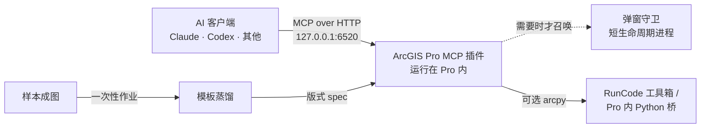

[](README.md) [](README.zh-CN.md) [](LICENSE) [](https://www.esri.com/en-us/arcgis/products/arcgis-pro/overview) []()

# ArcGIS Pro MCP · 优化版（AgentKit）

**一个开源优化版 ArcGIS Pro MCP：一个仓库、三部分——MCP 插件、按需弹窗守卫、按需模板蒸馏。**

> ### 上游项目与原作者
> MCP 模块基于 **[Knight60/ArcGIS-Pro-MCP](https://github.com/Knight60/ArcGIS-Pro-MCP)**，原作者 **Pisut Nakmuenwai**，
> 采用 **AGPL-3.0-or-later** 许可。本项目在其基础上累计本地补丁至 **v1.1.4**，并新增守卫与蒸馏两个模块。
> 上游署名与修改声明保留在 [NOTICE](NOTICE) 与客户包内的源码快照中。

---

## 这是什么

让 AI 助手（Claude、Codex 或任意 MCP 客户端）直接操作你正开着的 ArcGIS Pro 工程：你的数据、你的地图、你的布局。不复制、不导出、不经过云端。

| | 模块 | 作用 | 状态 |
|---|---|---|---|
| **A** | **MCP** | ArcGIS Pro 插件：113 个原生工具（进程内执行，约 9 ms）、全部地理处理工具、可选的 RunCode / Python 桥 arcpy 通道。监听 `127.0.0.1:6520/mcp`。 | 客户版 v1.1.4 已发布在 [`customer-v1.1.4`](../../tree/customer-v1.1.4) 分支 |
| **B** | **Guard** | 按需弹窗守卫：只在可能触发“第三方代码库”信任框的操作前被召唤，操作结束即退出；平时零进程、零轮询。 | 骨架（设计见 [docs/design-2026-11-16.md](docs/design-2026-11-16.md) §3） |
| **C** | **Distill** | 按需模板蒸馏：把一张样本成图蒸馏为可复用的版式 spec——确定性测量、助手按规范做语义判读、校验、预览、评审，一次作业、无守护进程。 | 骨架（设计见 [docs/design-2026-11-16.md](docs/design-2026-11-16.md) §4） |

### 为什么强调“按需”

- **不常驻**：没有危险操作时，系统里没有守卫进程、没有后台轮询。
- **守卫只活一次操作**：在可能触发信任框的操作前召唤，操作结束自动收队；自动点击成功则用户无感，失败才弹出置顶警报（≥30 秒、响铃）。它只点“第三方代码库执行”信任框，绝不触碰覆盖/删除等确认框。
- **蒸馏是一次性作业**：不监听 inbox、不起服务，需要时运行；每一步幂等、可断点续做。



---

## 快速开始 —— 客户版（v1.1.4）

开箱即用的完整包——add-in、stdio 桥、RunCode、弹窗守护、Python 桥、安装器、文档与 AGPL 源码快照——发布在独立分支：

- 浏览：[**`customer-v1.1.4`**](../../tree/customer-v1.1.4)
- 下载：[**ZIP 打包**](https://github.com/XNYGggg/arcgis-pro-mcp-optimized/archive/refs/heads/customer-v1.1.4.zip)

1. 解压到任意目录，双击 `install/00-install.cmd`（不需要管理员权限；要求 ArcGIS Pro **3.7+**）。
2. 打开 ArcGIS Pro；首次加载未签名 add-in 时选择“是/信任”。确认顶部 **MCP 选项卡** 显示 **running**（端口 `127.0.0.1:6520`）。
3. 接入你的 AI 客户端（见下表）。
4. 运行 `install/01-check.cmd`，全部 `[OK]` 即就绪。

无需安装 Python、pip,也无需联网：add-in 运行在 ArcGIS Pro 3.7+ 自带的 .NET 运行时上，stdio 桥与守卫使用 Windows 自带的 PowerShell。包内 `SHA256SUMS.txt` 覆盖每一个文件。

### 接入 AI 客户端

| 客户端 | 做法 |
|---|---|
| **Claude Code** | `claude mcp add --transport http arcgis http://127.0.0.1:6520/mcp` |
| **Claude Desktop** | 完全退出应用后运行 `install/02-configure-claude.cmd`（自动写入并备份配置） |
| **Codex** | 在 `~/.codex/config.toml` 中加入 `[mcp_servers.arcgis]` 与 `url = "http://127.0.0.1:6520/mcp"` |
| **其他 MCP 客户端** | 以 Streamable HTTP 连接 `http://127.0.0.1:6520/mcp` |

---

## 仓库结构

```
├── main（本分支）             项目骨架：guard + distill 模块与设计文档
├── customer-v1.1.4            开箱即用客户版（add-in 1.1.4 + 全部运行组件）
├── src/arcgis_agentkit/       guard / distill Python 包（CLI 骨架）
├── skills/                    给助手的技能说明（template-distill、arcgis-pro-mapping）
├── library/                   模板库 schema（v1）与示例
├── docs/                      设计与架构文档
└── tests/                     pytest 冒烟测试
```

开发安装：

```powershell
python -m pip install -e .
arcgis-guard doctor
arcgis-distill doctor
```

## 路线图

1. **M1 — 守卫 v1**：召唤协议、UIA 事件优先检测、add-in 在 `run_python_toolbox_tool` 前后自动 arm/settle、Pester 测试。
2. **M2 — 蒸馏 v1**：import / measure / validate / preview / 模板库，`template-distill` 技能与模板 MCP 工具。
3. **M3 — 开源发布**：版本归一、双语文档、CI、Release 资产、干净机器演练。

详细设计、验收标准与取舍记录：[docs/design-2026-11-16.md](docs/design-2026-11-16.md)。

---

## 许可、致谢与免责声明

- **许可**：[AGPL-3.0-or-later](LICENSE)。由于 MCP 模块衍生自 AGPL-3.0-or-later 项目，合并仓库同样采用 AGPL-3.0-or-later。
- **上游项目与原作者**：[Knight60/ArcGIS-Pro-MCP](https://github.com/Knight60/ArcGIS-Pro-MCP)，作者 **Pisut Nakmuenwai**——感谢原作者。本地修改声明见 [NOTICE](NOTICE)、[RELEASE-NOTES.md](https://github.com/XNYGggg/arcgis-pro-mcp-optimized/blob/customer-v1.1.4/RELEASE-NOTES.md) 与客户包内 `source/SOURCE-NOTICE.md`。
- **商标**：本项目与 Esri 无隶属关系；“ArcGIS”是 Esri 的商标，本项目为第三方工具。
- **隐私/网络**：所有服务仅绑定 `127.0.0.1`；无遥测、无云端调用。
- **维护者**：柳皓文（[@XNYGggg](https://github.com/XNYGggg)）。

[English version](README.md)
